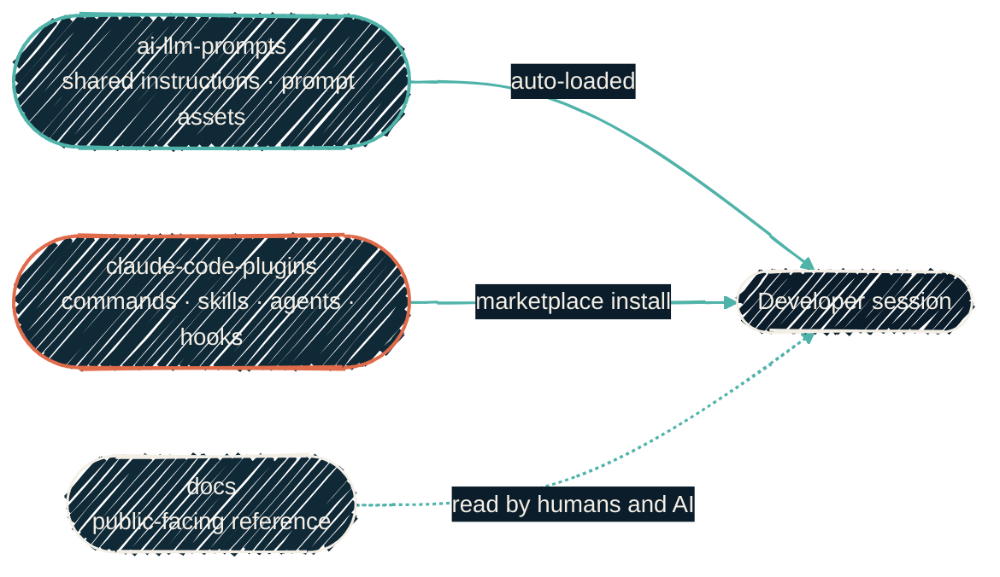

{/* projected from the authoring site; do not edit here */}
import { RepoFit } from "/snippets/repo-summary.mdx";

> Three repositories. Each one owns a different layer of the AI development stack. No overlap, no duplication.

The AI coding setup behind this site is split across three repositories on purpose. One holds the
*shared instructions* that every AI tool reads. One holds the *plugins* that extend Claude Code
specifically. One holds the *documentation* you are reading right now. Keeping them separate lets
each layer evolve at its own pace.

## What each repo owns

| Repository | Layer | Owns |
| --- | --- | --- |
| [`ai-llm-prompts`](/automation/repos/ai-llm-prompts) | Shared instructions | `AGENTS.md`, `CLAUDE.md`, `agentsmd/**`, and prompt assets |
| [`claude-code-plugins`](/ai-development/claude-code-plugins) | Plugins | Slash commands, skills, agents, hooks, the plugin marketplace |
| [`docs`](/introduction) | Documentation | This site: architecture, narrative, public-facing diagrams |

The former `ai-assistant-instructions` repository now holds a pointer to the
shared instruction tree and remains until an operator archives it.

The instruction catalog is vendor-agnostic. Claude Code, Antigravity, GitHub Copilot, and Codex read
the shared files. The plugins repo is Claude-Code-specific because plugins are a Claude Code concept.
The docs repo is for humans and AI that need to understand the system.

Tool *permissions* (the allow / ask / deny lists) are not in any of these
repos. They live in the Nix layer at [`nix-claude-code`](/nix/nix-claude-code)
and are rendered into each tool's settings by `nix-ai`.

## How the layers compose

Green is rules, coral is plugins, ivory is documentation. Solid arrows are runtime composition:
both rules and plugins load into a session and behave as one configuration surface. The dashed arrow
is asynchronous: docs are reference material, not loaded at runtime.

<RepoFit>
The rule of thumb: anything an AI tool needs at runtime lives in one of the first two repos. Anything a person needs to *understand* the system lives in the docs repo.
</RepoFit>

## How updates flow

Each repo releases on its own clock and notifies the others through plain GitHub mechanisms: no shared tooling required.

- **`ai-llm-prompts`** owns its release schedule. Its `instructions` flake package delivers the
  shared files; the [catalog page](/automation/repos/ai-llm-prompts) explains its versioning.
- **`claude-code-plugins`** also uses release-please. Published versions appear in the Claude Code plugin marketplace and are installed per-project on demand.
- **`docs`** auto-deploys on push to `main` via the Mintlify GitHub app. No release tags: the site is always the current state of `main`.

A change that affects the public picture (a new plugin, a renamed rule, a
shifted boundary) gets mirrored into the docs repo. That happens in the same
change set. The reverse is never true: docs do not push back into the source
repos.

## Related repos

<CardGroup cols={2}>
<Card
  title="How it fits together"
  icon="layer-group"
  href="/how-it-fits-together">
  The portfolio-level view. AI development is one of five public surfaces.
</Card>
<Card
  title="AI pipeline"
  icon="diagram-project"
  href="/architecture/ai-pipeline">
  How the rules + plugins + automation compose into an actual development loop.
</Card>
<Card
  title="ai-llm-prompts"
  icon="book"
  href="/automation/repos/ai-llm-prompts">
  The shared instructions and prompt catalog.
</Card>
<Card
  title="claude-code-plugins"
  icon="plug"
  href="/ai-development/claude-code-plugins">
  The plugins layer. Commands, skills, agents, and hooks for Claude Code.
</Card>
</CardGroup>
