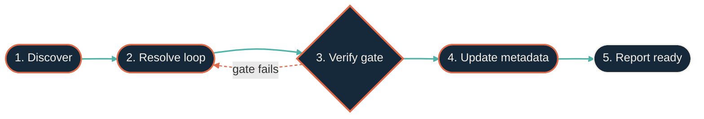

{/* projected from the authoring site; do not edit here */}
One command. Commit, push, open the PR, fix CodeQL, resolve threads, fix CI, and verify the
checks. It never merges. Pull-request merge behavior follows
[PR conventions](/conventions/pr-conventions).

`/ship` provides local support for the event-driven pull-request flow. See
[PR conventions](/conventions/pr-conventions) and
[CI/CD policy](/infrastructure/cicd/policy) for its lifecycle and checks.

## What `/ship` does

`/ship` is a thin orchestrator. It detects uncommitted changes (commits them), discovers recently created PRs, then for each PR invokes `/finalize-pr`, which is where the real work happens.

```text
/ship
  ├─ Step 0: verify git repo
  ├─ Step 1: commit any uncommitted changes; discover PRs in scope
  ├─ Step 1.5: build a context brief from the conversation
  ├─ Step 2: invoke /finalize-pr per PR, sequentially
  └─ Step 3: re-verify each PR with live GitHub state before reporting
```

## What `/finalize-pr` does

`/finalize-pr` is the loop. Five phases per PR:

{/*Shape: linear chain. Boundary crossings: 0. Ranks: 5×1. */}
{/* Aspect: ~3:1 (LR). Pass.*/}



| Phase | What it owns |
| --- | --- |
| 1. Discover | Resolve which PR or PRs to act on (current branch, all, or org-wide) |
| 2. Resolve loop | Start CI monitor in background; in parallel: invoke `/resolve-codeql fix`, `/resolve-pr-threads`, merge-conflict resolution; once CI completes, run `/simplify` once on the cumulative changes |
| 3. Verify gate | Re-query live GitHub state: `state`, `mergeable`, `statusCheckRollup.state`, all `reviewThreads.isResolved`, CodeQL alert count. [CI/CD policy](/infrastructure/cicd/policy) assigns the checks |
| 4. Update metadata | A subagent updates PR title, description, linked issues |
| 5. Report ready | Emit the canonical PR status block |

## What it never does

- **Never merges or supplies the verdict.** The platform handles those steps; see
  [PR conventions](/conventions/pr-conventions) and
  [CI/CD policy](/infrastructure/cicd/policy#required-checks).
- **Never crosses org boundaries** in org-wide mode.
- **Never bypasses branch protection.**

## Subagents in the call chain

```text
/ship → /finalize-pr → /resolve-codeql fix
                     → /resolve-pr-threads → superpowers:receiving-code-review
                     → /simplify
                     → haiku subagent (PR metadata update)
                     → background CI monitor (Task tool)
```

Each subagent runs scoped to its task and reports back. The orchestrator re-verifies live state. It never trusts a subagent's self-report as ground truth.

## When to use `/ship` vs the cloud pipeline

| Situation | Use |
| --- | --- |
| Issue is filed, you want a PR drafted without thinking | [`ai-workflows`](/automation/repos/ai-workflows) (the cloud pipeline triggered on issue open) |
| You're editing a PR locally and want CI/threads/CodeQL handled in one command | `/ship` from your Claude Code session |
| You want to check a PR's current gate status | `/finalize-pr <N>` directly: reports the current state without re-running fixes |

## Where to go next

<CardGroup>
<Card
  title="CodeQL resolution"
  icon="shield-check"
  href="/ai-development/skills/codeql-resolution">
  Why CodeQL is fixed separately from CI checks, and what `/resolve-codeql` does.
</Card>
<Card
  title="claude-code-plugins"
  icon="plug"
  href="/ai-development/claude-code-plugins">
  The plugin home for `/ship`, `/finalize-pr`, and all the supporting skills.
</Card>
<Card
  title="Source: ship/SKILL.md"
  icon="github"
  href="https://github.com/dryvist/claude-code-plugins/blob/main/github-workflows/skills/ship/SKILL.md">
  The full skill definition.
</Card>
<Card
  title="Source: finalize-pr/SKILL.md"
  icon="github"
  href="https://github.com/dryvist/claude-code-plugins/blob/main/github-workflows/skills/finalize-pr/SKILL.md">
  Phases, gates, and status reporting.
</Card>
</CardGroup>
