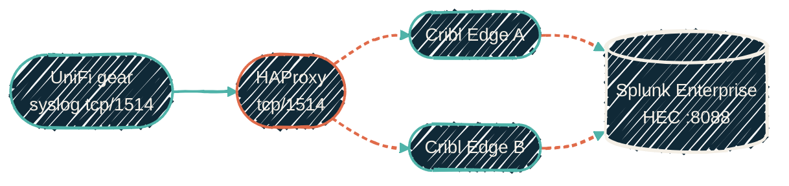
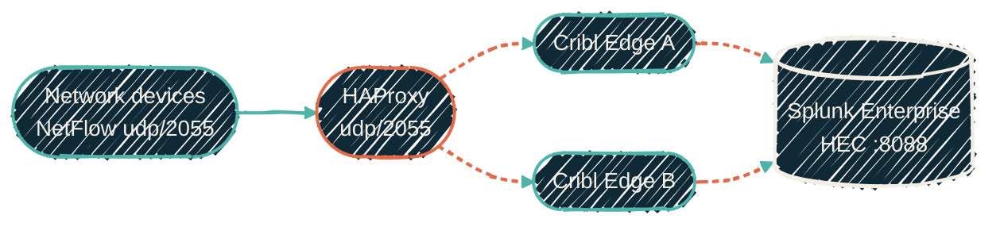

{/* projected from the authoring site; do not edit here */}
Two pipelines move data from the homelab edge to Splunk. The architecture is intentional. HAProxy
load-balances toward Cribl Edge, which routes, transforms, and reduces volume before forwarding to
Splunk over HEC.

The goal is a 30–50% volume reduction without losing security signal.

## Cribl is the hub, native first

Meet each new data need from signals already flowing into Cribl Stream or Edge.
Start with a native transform (Aggregations, Publish Metrics, Lookup, or Eval), then add a route.
Do not add an exporter, poller, proxy, or credential for data that already flows there.
Prefer a native flag on an existing agent, such as a `node_exporter` collector flag, or load a kernel module.

When Cribl does not have the data, add it with the least new software:

1. A native Cribl source, such as a Redfish REST Collector, SNMP, NetFlow/IPFIX, or a Prometheus scrape.
2. Cribl Edge system metrics.
3. A single tool Cribl scrapes, only when the vendor offers no stream. [unpoller](/observability/monitoring-agents)
   is the approved case because UniFi controller stats are API-only.

Producers emit once to Cribl. A producer wired straight to one sink is the pattern this architecture replaces.

## Fan-out: every source to every destination

By default, each source goes to every compatible destination. This rule matters most for low-volume data.
No source gets its own one-off destination:

| Signal | Destinations |
| --- | --- |
| Metrics | the metrics store **and** the Splunk metrics index |
| Events / logs | Splunk, plus any other event store that applies |
| Traces | Langfuse and [Phoenix](/observability/phoenix) (merged, not yet deployed); Cribl excludes traces from its Splunk route |

Each single-destination route needs a reason in its pull request. Data duplication lets teams compare
the same signal across systems. Do not remove a feed because another sink carries the same data.
Fix a failing feed instead. See [LLM observability](/observability/llm-observability) and
[Pipeline flows](/observability/pipeline-flows) for the live OTLP fan-out and its current
Langfuse/Phoenix legs.

## Consumers read their entity set from config

A dashboard or other consumer draws its entity set (nodes, VLANs, apps) from configuration, not
from whichever series happen to come back from a query. A missing series shows as stale data with
its age, then as `no data since …`. It never silently disappears from the view. Remove an entity
from a dashboard by removing it from config, not by relying on a query that stops returning it.

## Versions: bot pull requests only

Renovate supplies dependency and pipeline-component bumps, including flake locks. See
[Dependency automation](/infrastructure/cicd/dependency-automation) for the shared schedule and
lock policy. Do not hand-write bumps, pin hashes, or run `nix flake update` on bot-managed inputs in
these repositories.

## Log pipeline

UniFi network gear and app logs land in Splunk via Cribl Edge. HAProxy fronts the Cribl Edge cluster for high availability.

{/*Shape: parallel convergence (HAProxy fans to A+B, both converge on Splunk). */}
{/* Boundary crossings: 0. Ranks: 4. Aspect: ~3:1 LR. Pass.*/}

Coral dashed edges carry the data; the solid green edge is the physical syslog hop. Cribl Edge drops
verbose fields, routes by `event_type`, and enriches and masks the rest. The indexer takes a smaller,
cleaner payload.

## NetFlow pipeline

NetFlow v9 / IPFIX from network devices follows the same shape on a different port. UDP is loss-tolerant by design, so HAProxy distributes rather than fails over.

{/*Shape: parallel convergence. Identical topology to log pipeline, udp/2055.*/}

Cribl pipelines de-duplicate, parse flow records, and aggregate by tuple before forwarding.

## What lives where

| Layer | Provisioned by | Configured by | Source repo |
| --- | --- | --- | --- |
| Proxmox host / VMs / LXCs | [tofu-proxmox](https://github.com/dryvist/tofu-proxmox) | [ansible-proxmox](https://github.com/dryvist/ansible-proxmox) | both |
| HAProxy | (Ansible role) | [ansible-proxmox-apps](https://github.com/dryvist/ansible-proxmox-apps) | apps repo |
| Cribl Edge | (Ansible role) | [ansible-proxmox-apps](https://github.com/dryvist/ansible-proxmox-apps) | apps repo |
| Splunk Enterprise | (manual / Ansible) | [ansible-splunk](https://github.com/dryvist/ansible-splunk) | splunk repo |
| Cribl pipelines and routes | Cribl packs | Function-specific pack repos | [Observability overview](/observability/overview#reusable-observability-content) |
| Splunk apps and knowledge objects | Splunk app packages | Function-specific app repos | [Observability overview](/observability/overview#reusable-observability-content) |

## DR posture

`tf-splunk-aws` provisions an on-demand Splunk or Cribl environment on AWS with plain OpenTofu.
Start or stop it as needed. It accepts the same HEC traffic if the home cluster is offline.
Cribl Stream's output can be flipped from the homelab HEC to the AWS HEC by a routing-rule change.
See Observability stack for the
current toggle and schedule.
