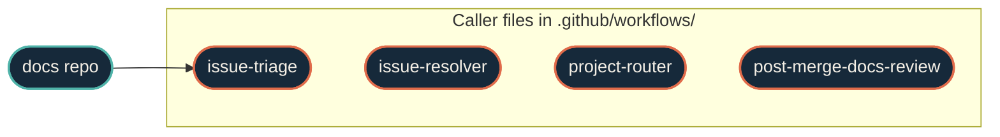

{/* projected from the authoring site; do not edit here */}
Open issue. Don't open the dashboard. Come back in five minutes to a ready PR labeled `human:review`.

The pipeline on this repo, [`dryvist/docs`](https://github.com/dryvist/docs), uses six thin
caller files in `.github/workflows/` that delegate to reusable workflows in
[`JacobPEvans/.github-ai`](https://github.com/JacobPEvans/.github-ai). Each caller is 10–30
lines; the AI work all lives in the upstream reusable workflow.

## What runs, in order

| Step | Trigger | Caller file | Reusable workflow | What it does |
| --- | --- | --- | --- | --- |
| 1 | `issues: [opened]` | `issue-triage.yml` | `JacobPEvans/.github-ai/.github/workflows/issue-triage.yml` | Categorizes, deduplicates, labels |
| 2 | `issues: [opened]` | `issue-resolver.yml` | `JacobPEvans/.github-ai/.github/workflows/issue-resolver.yml` | Creates a ready PR labeled `human:review` if the issue is well-scoped and not on the excluded-labels list |
| 3 | `pull_request: opened/synchronize/ready_for_review` | (no caller: handled by upstream reviewers) | external Gemini + Copilot reviews | Posts inline review comments |
| 4 | Failed CI completion | — | — | See CI resolver for the repair path and cutover status. |
| 5 | `issues: [opened, labeled]`, `pull_request: [opened, ready_for_review]` | `project-router.yml` | `JacobPEvans/.github-ai/.github/workflows/project-router.yml` | Routes the item to the right GitHub Project with smart field assignment |
| 6 | `push: [main]` → re-dispatched as `workflow_dispatch` | `post-merge-docs-review.yml` | `JacobPEvans/.github-ai/.github/workflows/post-merge-docs-review.yml` | After merge, audits docs touched by the commit and creates fix PRs if needed |
| 7 | Human clicks **Merge** | n/a | n/a | The only manual step |

## How the six callers connect

{/*Shape: hub-and-spokes. 1 hub, 4 leaves stacked via invisible links. */}
{/* Aspect: ~4:3 (LR). Pass.*/}



The hub is the consumer repo; each caller is a one-shot wrapper around an upstream reusable workflow. They run independently when their trigger fires.

## What each caller actually contains

A caller is the minimum YAML to declare a trigger, set permissions, and call the upstream:

```yaml
name: Issue Triage
on:
  issues:
    types: [opened]
permissions:
  contents: read
  id-token: write
  issues: write
jobs:
  run:
    uses: JacobPEvans/.github-ai/.github/workflows/issue-triage.yml@v1
    secrets: inherit
```

Two patterns are slightly larger:

- **`post-merge-docs-review.yml`** uses the [Post-Merge Dispatch
  Pattern](https://github.com/JacobPEvans/.github-ai/blob/main/docs/PATTERNS.md#post-merge-dispatch-pattern).
  It is a two-job file because `push` events aren't supported by `claude-code-action@v1`, so the caller
  re-dispatches as `workflow_dispatch`.

## Secrets the pipeline needs

| Secret / variable | Purpose |
| --- | --- |
| `AI_TOKEN` | Provider credential |
| `AI_PROVIDER` | Optional provider route |
| `AI_BASE_URL` | Optional API endpoint |
| `GH_APP_CLAUDE_BOT_PRIVATE_KEY` | App private key |
| `GH_APP_CLAUDE_BOT_ID` | App identifier |

## Rate and safety guards

The reusable workflows enforce conservative defaults so a runaway loop can't burn cloud spend:

- **`issue-resolver.yml`**: `max_attempts: 1` per issue, `daily_limit: 5` per repo, and it skips any issue labeled `excluded_labels: "type:security,type:feature,type:breaking,size:l,size:xl"`
- **All workflows**: fork PRs blocked by `if:` guards, branch protection enforces the final merge gate

## The pieces this doesn't include

The cloud pipeline opens a ready PR labeled `human:review` and provides AI review. It does NOT:

- Mark the PR ready for merge: that's a human decision
- Click the merge button: never automated
- Override branch protection or required reviewers
- Touch repos outside the current org boundary

For the local iteration loop on a PR you're editing yourself, see [`/ship` and `/finalize-pr`](/ai-development/skills/ship-and-finalize).

## Where to go next

<CardGroup>
<Card
  title="ai-workflows"
  icon="github"
  href="/automation/repos/ai-workflows">
  Reusable workflows, pinned catalog prompts, event-triggered and scheduled.
</Card>
<Card
  title="claude-code-routines"
  icon="clock"
  href="/automation/repos/claude-code-routines">
  The cron half: six routines that scan the org and pick up loose ends.
</Card>
<Card
  title="ai-workflows getting started"
  icon="book"
  href="https://github.com/JacobPEvans/.github-ai/blob/main/docs/GETTING_STARTED.md">
  Caller templates and the live workflow catalog.
</Card>
<Card
  title="Authentication"
  icon="key"
  href="https://github.com/JacobPEvans/.github-ai/blob/main/docs/AUTHENTICATION.md">
  `AI_TOKEN`, provider routing, and model variables.
</Card>
</CardGroup>
