{/* projected from the authoring site; do not edit here */}
File an issue. Walk away. Come back to a ready PR labeled `human:review`, with green CI and AI review.

This is the **issue → mergeable PR** pipeline. Three repos collaborate: `ai-workflows` runs on
GitHub Actions per consumer repo, `claude-code-routines` runs on Anthropic's cloud cron,
`claude-code-plugins` is the local Claude Code escape hatch.

## The end-to-end shape

{/*Shape: linear chain. Boundary crossings: 0. Ranks: 6×1. */}
{/* Aspect: ~2.5:1 (LR). Pass.*/}

```mermaid
%%{init: {"theme":"base","look":"handDrawn","themeVariables":{"primaryColor":"#123a36","primaryTextColor":"#f4efe6","primaryBorderColor":"#4fb3a9","lineColor":"#4fb3a9","secondaryColor":"#0b1d2a","tertiaryColor":"#16293a","clusterBkg":"#08151f","clusterBorder":"#4fb3a9","fontFamily":"'Geist Sans', system-ui, -apple-system, BlinkMacSystemFont, 'Segoe UI', Roboto, sans-serif","fontSize":"14px"}}}%%
flowchart LR
  classDef src fill:#16293a,stroke:#e06b4a,stroke-width:2px,color:#f4efe6;
  classDef ai fill:#16293a,stroke:#e06b4a,stroke-width:2px,color:#f4efe6;
  classDef gate fill:#16293a,stroke:#e06b4a,stroke-width:2.5px,color:#f4efe6;
  classDef hop fill:#16293a,stroke:#4fb3a9,stroke-width:2px,color:#f4efe6;
  classDef host fill:#16293a,stroke:#4fb3a9,stroke-width:2px,color:#f4efe6;
  classDef sink fill:#16293a,stroke:#f4efe6,stroke-width:2px,color:#f4efe6;
  classDef auto fill:#16293a,stroke:#f4efe6,stroke-width:1.5px,color:#f4efe6;
  classDef external fill:#16293a,stroke:#e6b35a,stroke-width:2px,color:#f4efe6;
  I([Issue])
  T([AI triage])
  D([Ready PR])
  L([CI and review loop])
  G{Final gate}
  M([Merged])

  I --> T --> D --> L --> G --> M

  class I src
  class T,L ai
  class D auto
  class G gate
  class M sink
```

A human files the issue, reviews the PR, and clicks merge. The `human:review` label marks the gate; auto-merge stays off.

## The three layers

| Layer | Where it lives | When it runs | What it owns |
| --- | --- | --- | --- |
| [Cloud pipelines](/automation/cloud-pipelines/overview) | GitHub Actions (per consumer repo) | Event-triggered (issues and PRs) | Triage, ready PRs labeled `human:review`, final review gate, project routing |
| [Scheduled routines](/automation/scheduled-routines/overview) | Anthropic cloud cron | Scheduled (cron 2×/day to weekly) | Org-wide maintenance: daily polish, issue solver, sentinel audit, weekly scorecard |
| [Skills](/ai-development/skills/overview) | Your laptop | Interactive (`/ship` from any Claude Code session) | The local escape hatch: finalize a PR you're iterating on |

CI repair workflows and their cutover status live in CI resolver.

## Where to go next

<CardGroup>
<Card
  title="Issue → PR pipeline"
  icon="route"
  href="/automation/issue-to-pr-pipeline">
  The eight-step cloud flow on a target repo. Which trigger fires which file, who reviews, what gates merge.
</Card>
<Card
  title="Cloud pipelines"
  icon="github"
  href="/automation/cloud-pipelines/overview">
  Reusable workflows and pinned catalog prompts behind the GitHub Actions automation surface.
</Card>
<Card
  title="Scheduled routines"
  icon="clock"
  href="/automation/scheduled-routines/overview">
  Cron-scheduled Claude routines. Org-wide maintenance, no per-repo wiring.
</Card>
<Card
  title="Skills"
  icon="ship"
  href="/ai-development/skills/overview">
  Local Claude Code slash commands, such as `/ship` and `/resolve-codeql`, that close the loop on a PR you are iterating on.
</Card>
</CardGroup>

## Source repos

[`ai-workflows`](https://github.com/JacobPEvans/.github-ai) · [`ai-llm-prompts`](https://github.com/dryvist/ai-llm-prompts) ·
[`claude-code-routines`](https://github.com/dryvist/claude-code-routines) ·
[`claude-code-plugins`](https://github.com/dryvist/claude-code-plugins). The 30-second pitch lives at
[AI pipeline](/architecture/ai-pipeline); this Automation section is the mechanics.
