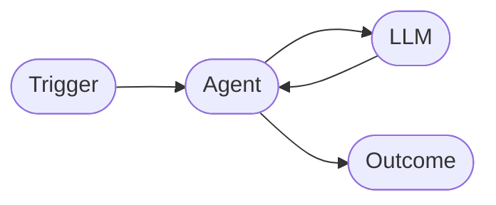

{/* projected from the authoring site; do not edit here */}
Hermes runs homelab agents as locked profiles. Git holds each profile
definition, schedule, and fleet-board row. The router is the front door for
every caller and agent.

## Agent path

```mermaid
%%{init: {"theme":"base","look":"handDrawn","themeVariables":{"primaryColor":"#123a36","primaryTextColor":"#f4efe6","primaryBorderColor":"#4fb3a9","lineColor":"#4fb3a9","secondaryColor":"#0b1d2a","tertiaryColor":"#16293a","clusterBkg":"#08151f","clusterBorder":"#4fb3a9","fontFamily":"'Geist Sans', system-ui, -apple-system, BlinkMacSystemFont, 'Segoe UI', Roboto, sans-serif","fontSize":"14px"}}}%%
flowchart LR
  classDef src fill:#16293a,stroke:#e06b4a,stroke-width:2px,color:#f4efe6;
  classDef ai fill:#16293a,stroke:#e06b4a,stroke-width:2px,color:#f4efe6;
  classDef gate fill:#16293a,stroke:#e06b4a,stroke-width:2.5px,color:#f4efe6;
  classDef hop fill:#16293a,stroke:#4fb3a9,stroke-width:2px,color:#f4efe6;
  classDef host fill:#16293a,stroke:#4fb3a9,stroke-width:2px,color:#f4efe6;
  classDef sink fill:#16293a,stroke:#f4efe6,stroke-width:2px,color:#f4efe6;
  classDef auto fill:#16293a,stroke:#f4efe6,stroke-width:1.5px,color:#f4efe6;
  classDef external fill:#16293a,stroke:#e6b35a,stroke-width:2px,color:#f4efe6;
  G[Git] --> P[Prompt pack]
  P --> H[Locked Hermes profile]
  H --> R[Router agent name]
  R --> M[Local model and allowed tools]
  M --> A[Answer]

  classDef node fill:#102937,stroke:#4FB3A9,stroke-width:2px,color:#F4EFE6;
  class G,P,H,R,M,A node
```

The router checks which caller may use each agent, model, and tool. It also
holds the off switch. The profile, schedule, and board declarations stay in
Git; the runtime checks for edits made outside Git before it writes.

## The agent loop

{/*Shape: linear loop. Boundary crossings: 1 (container). Nodes: 5. Aspect: ~3:1 LR. Pass.*/}

An event fires the agent (an issue, a schedule, an alert). Inside the
container, the agent calls the LLM and acts on its own tools. It loops until
it reaches an outcome: a PR, a commit, a report. Nothing in that loop needs a
human, because the boundary, not a human, is the safety control.

## The vendors all converged on this

All three command-line tool vendors publish the same guidance. Bypass flags belong
only inside an isolated environment. The real controls are credentials, network
egress, and git.

- **Anthropic**
  - **Bypass mechanism:** `--dangerously-skip-permissions`
  - **Isolation guidance:** Only inside a [devcontainer](https://code.claude.com/docs/en/devcontainer) or
    [sandbox](https://code.claude.com/docs/en/sandbox-environments); hard-rejected when running as root. Agent SDK secure deployment: never mount host secrets.
- **OpenAI Codex**
  - **Bypass mechanism:** `approval_policy` + `sandbox_mode` axes
  - **Isolation guidance:** [`--yolo`](https://developers.openai.com/codex/) (`danger-full-access` + `never`) only inside a container; network is off by default even in `workspace-write`.
- **Antigravity (`agy`)**
  - **Bypass mechanism:** `--dangerously-skip-permissions`
  - **Isolation guidance:** Its own sandbox is turned off and the posture is not coupled to it: the weakest pairing of the three,
    and the only tool that cannot carry the posture as a settings key at all, so the coupling is enforced by the launcher
    and the sandbox around it.

The convergent model:

- The container is the boundary.
- Bypass flags work only inside it.
- Default-deny egress.
- Short-lived, scoped credentials.
- Git is the safety net.

## Three profiles

Profiles are defined once in `nix-ai` and rendered to all three tools by the
existing formatter layer. See [nix-ai](/nix/nix-ai) for the rendering pipeline.

- **`interactive`**
  - **Where:** Mac host (unchanged)
  - **Claude:** current allow/ask/deny + auto mode
  - **Codex:** `workspace-write` + approvals
  - **Antigravity:** `auto_edit`
- **`autonomous`**
  - **Where:** inside containers ONLY
  - **Claude:** `bypassPermissions` + ~10-entry residual deny; `claude -p --bare --dangerously-skip-permissions`
  - **Codex:** `approval_policy="never"`, `sandbox_mode="danger-full-access"` (the container IS the boundary; nested bwrap needs a seccomp profile that permits user namespaces)
  - **Antigravity:** `--dangerously-skip-permissions`, its own sandbox off
- **`ci`**
  - **Where:** Actions runners
  - **Claude:** `autonomous` + JSON output overlay
  - **Codex:** same
  - **Antigravity:** same

One exception breaks the "configs only, no flags" shape. Antigravity has no
settings key that can carry the posture. Its predecessor hard-errors on the
equivalent key and refuses to start. So every autonomous `agy` run must pass
`--dangerously-skip-permissions` on the command line, and the launcher asserts
the flag is present. The rendered settings block for it exists for parity, not
effect.

## What happens to the 640 entries

They survive only in `interactive`. The autonomous profile keeps a residual deny of
roughly ten entries (`gh repo delete`, `gh secret`, force-push, registry publish)
as a tripwire, not a wall. In `autonomous`, the real protection is:

- **Credential scoping**: the agent holds only short-lived, narrowly scoped tokens.
- **Network boundary**: an allowlisting egress proxy is the only way out.
  See [Runtime](/autonomous-agents/runtime).

A permission list cannot protect an unattended agent anyway. Anything the config
allows, a confused or compromised agent does. Anything it asks about blocks
forever with no human present. Boundaries that hold without a human are the ones
made of credentials and packets.

## Structural guarantees

Two invariants are enforced in code, not convention:

1. **Autonomous configs exist only inside a boundary**: baked into the
   container image, or rendered by the converge role onto a pool guest. No code
   path writes a bypass-mode settings file onto a workstation filesystem. You
   cannot accidentally run yolo on the Mac host because the config to do so does
   not exist there.
2. **The entrypoint refuses to start** unless `AGENT_SANDBOX=1` is set and the uid
   is not 0. Claude Code independently hard-rejects bypass as root; the image runs
   as `agent` (uid 1000) with no sudo.

<Warning>
The container boundary is only as strong as what crosses it. Never mount host
secrets, the Docker socket, or writable host paths into an agent container. The
[runtime page](/autonomous-agents/runtime) defines exactly what an agent container
may see.
</Warning>

## Where agents run

Service agents are profiles in one service guest. Identity assistants keep
their own guests. The placement page records the measured node and replica
targets.

## Views

The Hermes dashboard shows one agent's setup and runs. Langfuse shows a run's
trace. Paperclip lists the fleet and starts a run on request; it does not fire
schedules. See the control layer
for access and board details.

## Pages

<CardGroup>
<Card
  title="Runtime"
  href="/autonomous-agents/runtime">
  Profile rendering, scheduled runs, and Git source checks.
</Card>
<Card
  title="Operating profiles"
  href="/autonomous-agents/hermes-operating-profiles">
  Shared prompt text and memory-service rules.
</Card>
</CardGroup>

## In this section

<CardGroup>
</CardGroup>
