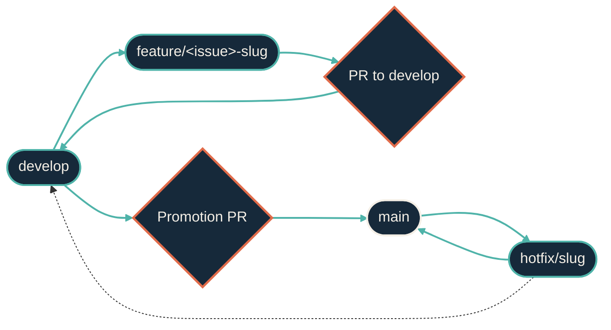

{/* projected from the authoring site; do not edit here */}
Read the type and the scope from the branch name alone. No `git log` required.



## Which model applies

Every repo runs one of two branch models. Check the repo's default branch (`git remote show origin`
or the GitHub settings page). Never guess it from whatever branch happens to be checked out
locally:

- Default branch `develop` → the repo is on git-flow. Read [git-flow branch types](#git-flow-branch-types-repos-with-develop) below.
- Default branch `main` → the repo uses trunk flow. Read [trunk-flow branch types](#trunk-flow-branch-types-conventional-branch) below.

## Tiers

Every repository has a custom property `merge_tier` with the value `standard` or `hot`. It is the only switch
for tier behavior; see [GitHub org governance](/infrastructure/repos/tofu-github) for how it is declared
and changed. A repository is `hot` when it sees 20 or more pull requests a day.

- `hot`: GitHub's native merge queue guards the default branch, through a repository ruleset (merge
  method squash, grouping strategy ALLGREEN, up to 5 entries built and up to 5 merged together,
  minimum 1, no wait, 30-minute check timeout, no bypass actors). Heavy checks run once, in the
  queue, on the merged result.
- `standard`: no queue. Heavy checks run on the pull request. Native auto-merge merges it.

Setting `merge_tier` back to `standard` removes the queue ruleset in one apply; see [GitHub org governance](/infrastructure/repos/tofu-github) for rollback and the `merge_tier_override` variable.

## Branch names

| Branch | Who writes | Protection |
| --- | --- | --- |
| `develop` (git-flow) or `main` (trunk-flow) | The merge queue or native auto-merge | Protected; no direct pushes. |
| `topic/<name>` | Several agents push directly | Force pushes are blocked; each push runs the fast checks. |
| `green` | The automation App | Forward only; only the automation App moves it; no deletion. |
| `promote/<yyyy-mm-dd>` | Unspecified in the sources | Created at the exact commit of the daily promotion; accepted by the main source gate. |
| `hotfix/<name>` | Unspecified in the sources | Branches from `main` and targets `main`; accepted by the main source gate. |

## Topic branches

`topic/<name>` branches allow several agents to push to the same branch directly. Force pushes are
blocked. Each push runs the fast checks. One pull request lands the topic when it is complete.

A cross-repository topic uses the same branch name in each repository. Consumer CI tests against
the upstream topic branch through native overrides (Nix `--override-input`, an OpenTofu module
source variable, a Galaxy requirements override) that are never committed. The upstream lands
first. Each landing is safe to deploy alone.

## The branch green

The branch `green` points at the newest commit of the default branch whose deferred checks and
reviews have passed. With no deferred pull request since `green`, `green` moves to the new head at
once. Otherwise the heavy checks for everything changed since `green` run on the new head, and each
deferred pull request needs a MERGE verdict; then `green` moves. If they fail: a message goes to
the team chat at once, the CI-fix agent starts, and after 15 minutes a revert pull request is
opened with `gh pr revert` (label `auto-revert`) and lands through the bot lane. A CHANGES verdict
after merge reverts at once. `green` only moves forward, and only the automation App moves it.
Deploys and promotion read `green`, so a red default branch never deploys. First-party references track `main`; see [Dependency automation](/infrastructure/cicd/dependency-automation#first-party-pins).

## Promotion

Every day: if `main` has content that `develop` lacks (an unported hotfix), promotion stops and a
message is posted. Otherwise the full suite runs on the head of `green`. On success the branch
`promote/<yyyy-mm-dd>` is created at that exact commit, and a pull request to `main` is opened and
merges by merge commit; it runs light checks and verifies the full-suite result for its head commit.
On failure there is no promotion that day; a message is posted and the CI-fix agent starts. The
main source gate accepts the branches `develop`, `hotfix/<name>` and `promote/<yyyy-mm-dd>`.
`release-please` keeps its pull request on the default branch, tags releases on `main`, and a person makes major releases. See [CI/CD policy](/infrastructure/cicd/policy) for release rules.

## git-flow branch types (repos with `develop`)

git-flow repos use the branch model below. [Git Town](https://www.git-town.com) starts branches. It is installed and configured globally (nix-managed `git-town.*` git config).

| Branch | Role | Gets changes by |
| --- | --- | --- |
| `main` | Production. Protected; no direct pushes. | **Merge commits only**: squash and rebase into `main` are banned, no exceptions. |
| `develop` | Default integration branch. Protected; no direct pushes. | Pull requests merge by squash through the merge queue or auto-merge. |
| `<type>/<slug>` | One change's work. `<type>` is a [short type](#allowed-types-short-forms-only), never `feature`. | Branched from fresh `develop`. |
| `release-please--branches--develop` | The release PR | Opened and kept current by release-please against `develop`; auto-merges (squash) once checks pass. |
| `hotfix/<slug>` | Urgent production fix | Branched from `main`; PR to `main`, merge commit; a second PR from the hotfix branch carries the fix to `develop`. |

### Working a change

1. Create or switch to a fresh worktree based on `origin/develop`.
2. Start the branch there with `git town hack <name>`, or let the harness worktree create it. Git
   Town fetches first and bases the branch on the fresh `develop` tip. It adds no prefix, so
   `<name>` is the full branch name, for example `git town hack fix/123-inventory-loader`. Start it
   with the [short type](#allowed-types-short-forms-only) of the eventual commit. Lead the slug with
   the GitHub issue number when one exists. Never invent an issue number.
3. Commit atomically: one fix, one feature, or one coherent section of updates per commit. Follow
   [Commit conventions](/conventions/commit-conventions) and reference the issue (`#123`), using
   a closing keyword (`fixes #123`) when the change closes it.
4. Open the pull request against `develop`. It merges by squash through the merge queue or auto-merge.
5. A hotfix branch starts from `main` and targets `main` with a merge commit. A second pull request from the hotfix branch carries the fix into `develop`.

### Git Town usage

- **Start:** `git town hack <name>`. Never branch from a local `main` or `develop`. The agent hooks deny `checkout -b`, `switch -c` and a worktree add whose start point is not `origin/…`.
- **Sync:** Pull request branches do not need hand updates. See [PR conventions](/conventions/pr-conventions) for merge behavior.
- **Propose:** `git town propose` opens the PR against the parent.
- **Hotfix:** `git worktree add --no-track -b hotfix/<name> <abs-path> origin/main`.
- **Per-repo config:** a git-flow repo commits `.git-branches.toml` with `main = "develop"` (or sets
  `git-town.main-branch=develop`). Everything else comes from the global Nix config.

## Trunk-flow branch types (Conventional Branch)

Repos without a `develop` branch use trunk-based flow: no `hotfix/*` or release-please `develop`
branch, and PRs squash-merge straight into `main` (see [PR
conventions](/conventions/pr-conventions)).

Branch names follow [Conventional Branch](https://conventional-branch.github.io): a short type
prefix, a `/`, and a kebab-case description. The type matches the [commit
conventions](/conventions/commit-conventions) prefix that the eventual squash commit uses, so
the branch name predicts the changelog entry.

## Shape

```text
<type>/<short-kebab-case-name>
```

- `<type>` is one of the allowed short forms below, never the long form.
- `<short-kebab-case-name>` is lowercase, hyphen-separated, descriptive but tight (≤ 5 words is
  usually enough).
- An issue number may lead the name (`fix/123-dns-resolver-restart`). No usernames, no dates.

Examples:

| Good | Bad | Why |
| --- | --- | --- |
| `feat/add-syslog-firewall` | `feature/add-syslog-firewall` | Long form `feature`; banned. |
| `fix/dns-resolver-restart` | `bugfix/dns-resolver-restart` | Long form `bugfix`; banned. |
| `chore/pin-tofu-1.10` | `chore/JAC-127` | Issue ID instead of a description. |
| `docs/end-goal-sweep` | `docs/jacob-pe-friday-cleanup` | Author name; irrelevant in 6 months. |
| `refactor/extract-vlan-helper` | `refactor/v2` | Vague; says nothing. |

## Allowed types: short forms only

These match the [Conventional Commits](/conventions/commit-conventions) prefixes one-to-one.
**Always the short form.** `feat` not `feature`. `fix` not `bugfix`. No exceptions.

| Type | Use for |
| --- | --- |
| `feat/` | New capability, integration, or significant behavioral change. Maps to `feat:` commit → minor version bump. |
| `fix/` | Bug fix, small improvement, config tweak, dependency bump. Maps to `fix:` commit → patch bump. |
| `chore/` | Maintenance that does not affect users: formatting passes, internal refactors that change no behavior, repo hygiene. |
| `docs/` | Documentation-only changes (`README.md`, `docs/`, `*.mdx`, comments). No code changes. |
| `refactor/` | Code restructuring that intentionally changes neither behavior nor external API. |
| `test/` | Adding or fixing tests without changing the code under test. |
| `ci/` | CI/CD workflow changes (`.github/workflows/`, `pre-commit` config, runner pinning). |
| `build/` | Build-system / dependency changes (`flake.nix`, `package.json`, lockfiles) that don't fit `chore`. |
| `perf/` | Performance improvements that change neither behavior nor API. |
| `style/` | Pure formatting (whitespace, semicolons). Almost always swallowed into `chore` or `refactor`; rare. |

If two types fit, pick the one that produces the right version bump. `feat:` → minor, `fix:` →
patch, everything else → no version bump (per
[release-please](https://github.com/googleapis/release-please) defaults).

## Why short forms

The long forms (`feature`, `bugfix`) don't appear in any Conventional Commits / Conventional Branch
spec. Mixing both creates two parallel taxonomies that release tooling, branch protection rules,
and CODEOWNERS regexes have to match independently. One canonical set keeps everything (CI,
automation, AI agents, humans skimming `git branch`) on the same page.

The full Conventional Branch spec lives at
[conventional-branch.github.io](https://conventional-branch.github.io); the commitlint config that
enforces the matching commit prefixes is
[@commitlint/config-conventional](https://github.com/conventional-changelog/commitlint/tree/master/%40commitlint/config-conventional).
Its `hotfix/` type matches the git-flow hotfix branch above. Trunk-flow repos use neither `hotfix/`
nor `release/`.

## What this connects to

<CardGroup>
<Card
  title="Commit conventions"
  icon="code-commit"
  href="/conventions/commit-conventions">
  The matching commit prefix vocabulary. Branch type and commit type are one decision, made once.
</Card>
<Card
  title="PR conventions"
  icon="code-pull-request"
  href="/conventions/pr-conventions">
  PR title inherits the conventional-commit prefix from the branch.
</Card>
<Card
  title="Git transport"
  icon="lock"
  href="/conventions/git-transport">
  SSH for public, HTTPS for private. Picks transport by visibility, not by branch.
</Card>
<Card
  title="CI/CD policy"
  icon="scale-balanced"
  href="/infrastructure/cicd/policy">
  How `feat:` and `fix:` translate into release-please version bumps once the branch merges.
</Card>
</CardGroup>
