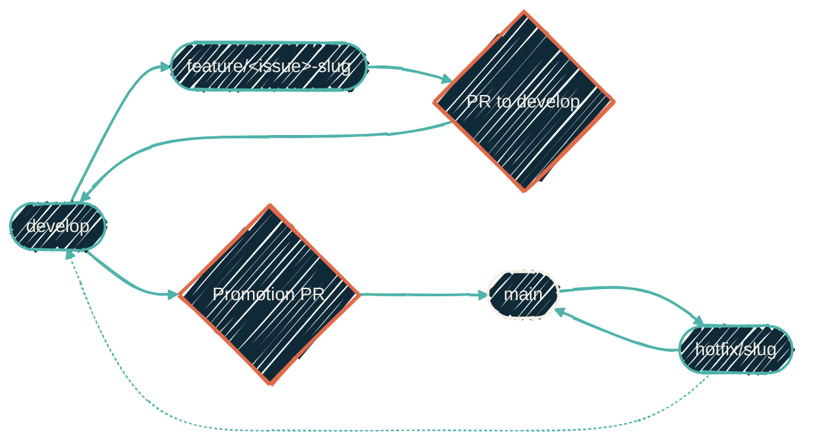

{/* projected from the authoring site; do not edit here */}
> Read the type and the scope from the branch name alone. No `git log` required.



## Which model applies

Every repo runs one of two branch models. Check the repo's default branch (`git remote show origin`
or the GitHub settings page). Never guess it from whatever branch happens to be checked out
locally:

- Default branch `develop` → the repo is on git-flow. Read [git-flow branch types](#git-flow-branch-types-repos-with-develop) below.
- Default branch `main` → the repo uses trunk flow. Read [trunk-flow branch types](#trunk-flow-branch-types-conventional-branch) below.

## git-flow branch types (repos with `develop`)

git-flow repos use the branch model below. [Git Town](https://www.git-town.com) starts and syncs
branches. It is installed and configured globally (nix-managed `git-town.*` git config).

| Branch | Role | Gets changes by |
| --- | --- | --- |
| `main` | Production. Protected; no direct pushes. | **Merge commits only**: squash and rebase into `main` are banned, no exceptions. |
| `develop` | Default integration branch. Protected but direct pushes allowed. | Squash-merged feature PRs (the default); merge commits for stacked work. |
| `<type>/<slug>` | One change's work. `<type>` is a [short type](#allowed-types-short-forms-only), never `feature`. | Branched from fresh `develop`. |
| `release-please--branches--develop` | The release PR | Opened and kept current by release-please against `develop`; auto-merges (squash) once checks pass. |
| `hotfix/<slug>` | Urgent production fix | Branched from `main`; PR to `main`, merge commit; a second PR from the hotfix branch carries the fix to `develop`. |

Releases are cut on `develop`, so `main` is never merged back. release-please keeps one release PR
open against `develop` with the version bump, CHANGELOG and release notes. That PR auto-merges
(squash) once its checks pass, so the release commit is the last release-related commit on `develop`.
Commits that land after it ship in the same promotion and take the next version. The tag and GitHub
Release are created when `main` receives the promotion, never earlier. See [PR conventions](/conventions/pr-conventions)
for the full merge-strategy breakdown.

### Promotion is a step you take, not an event that happens

Feature PRs squash into `develop`, then stop there. Nothing on `develop` reaches production until
someone opens a `develop` → `main` promotion PR and lands it with a **merge commit** (never squash,
never rebase). Each promotion merge publishes the release already prepared on `develop`.

This is the step that gets skipped. Features pile up on `develop`, and everything looks "done" in the
PR list. Meanwhile `main`, the branch releases are cut from, quietly falls weeks behind. Treat
promotion as part of finishing work, not a separate ceremony:

- When a change on `develop` is worth having in production, promote. Small, frequent promotions beat batched ones. Each release stays reviewable and revertible.
- Before calling a stretch of work complete, check `git log origin/main..origin/develop`. Commits listed there are merged into `develop`, **not shipped**.
- The promotion PR needs no new content. Its body is the list of squashed feature commits it carries.

### Working a change

1. Create or switch to a fresh worktree based on `origin/develop`.
2. Start the branch there with `git town hack <name>`, or let the harness worktree create it. Git Town
   fetches first and bases the branch on the fresh `develop` tip. It adds no prefix, so `<name>` is
   the full branch name, for example `git town hack fix/123-inventory-loader`. Start it with the
   [short type](#allowed-types-short-forms-only) of the eventual commit. Lead the slug with the
   GitHub issue number when one exists. Never invent an issue number.
3. Commit atomically: one fix, one feature, or one coherent section of updates per commit. Follow
   [Commit conventions](/conventions/commit-conventions) and reference the issue (`#123`), using
   a closing keyword (`fixes #123`) when the change closes it.
4. Open the PR against `develop`. Squash-merge ordinary feature PRs. Use a merge commit into
   `develop` only where preserving multiple atomic commits matters: stacked work, coordinated
   multi-commit changes.
5. `hotfix/*` is the one exception to PR targeting: it branches from `main`, its PR targets `main`
   directly with a merge commit (never squash), and a second PR from the hotfix branch (not from
   `main`) carries the fix into `develop`.
6. Small direct pushes to `develop` are fine; open a PR for anything reviewable.

### Git Town usage

- **Start:** `git town hack <name>`. Never branch from a local `main` or `develop`. The agent hooks
  deny `checkout -b`, `switch -c` and a worktree add whose start point is not `origin/…`.
- **Sync:** `git town sync` rebases the branch onto the fresh parent and pushes with lease. Never
  merge the base into a PR branch: a merge commit fails the org's Conventional Commit ruleset.
- **Propose:** `git town propose` opens the PR against the parent.
- **Hotfix:** `git worktree add --no-track -b hotfix/<name> <abs-path> origin/main`.
- **Releases** are not started by hand: release-please opens the release PR on `develop`.
- **Per-repo config:** a git-flow repo commits `.git-branches.toml` with `main = "develop"` (or sets
  `git-town.main-branch=develop`). Everything else comes from the global Nix config.

## Trunk-flow branch types (Conventional Branch)

Repos without a `develop` branch use trunk-based flow: no `hotfix/*` or release-please
`develop` branch, and PRs squash-merge straight into `main` (see [PR
conventions](/conventions/pr-conventions)).

Branch names follow [Conventional Branch](https://conventional-branch.github.io): a short type
prefix, a `/`, and a kebab-case description. The type matches the [commit
conventions](/conventions/commit-conventions) prefix that the eventual squash commit uses, so
the branch name predicts the changelog entry.

## Shape

```text
<type>/<short-kebab-case-name>
```

- `<type>` is one of the allowed short forms below, never the long form.
- `<short-kebab-case-name>` is lowercase, hyphen-separated, descriptive but tight (≤ 5 words is usually enough).
- An issue number may lead the name (`fix/123-dns-resolver-restart`). No usernames, no dates.

Examples:

| Good | Bad | Why |
| --- | --- | --- |
| `feat/add-syslog-firewall` | `feature/add-syslog-firewall` | Long form `feature`; banned. |
| `fix/dns-resolver-restart` | `bugfix/dns-resolver-restart` | Long form `bugfix`; banned. |
| `chore/pin-tofu-1.10` | `chore/JAC-127` | Issue ID instead of a description. |
| `docs/end-goal-sweep` | `docs/jacob-pe-friday-cleanup` | Author name; irrelevant in 6 months. |
| `refactor/extract-vlan-helper` | `refactor/v2` | Vague; says nothing. |

## Allowed types: short forms only

These match the [Conventional Commits](/conventions/commit-conventions) prefixes one-to-one. **Always the short form.** `feat` not `feature`. `fix` not `bugfix`. No exceptions.

| Type | Use for |
| --- | --- |
| `feat/` | New capability, integration, or significant behavioral change. Maps to `feat:` commit → minor version bump. |
| `fix/` | Bug fix, small improvement, config tweak, dependency bump. Maps to `fix:` commit → patch bump. |
| `chore/` | Maintenance that does not affect users: formatting passes, internal refactors that change no behavior, repo hygiene. |
| `docs/` | Documentation-only changes (`README.md`, `docs/`, `*.mdx`, comments). No code changes. |
| `refactor/` | Code restructuring that intentionally changes neither behavior nor external API. |
| `test/` | Adding or fixing tests without changing the code under test. |
| `ci/` | CI/CD workflow changes (`.github/workflows/`, `pre-commit` config, runner pinning). |
| `build/` | Build-system / dependency changes (`flake.nix`, `package.json`, lockfiles) that don't fit `chore`. |
| `perf/` | Performance improvements that change neither behavior nor API. |
| `style/` | Pure formatting (whitespace, semicolons). Almost always swallowed into `chore` or `refactor`; rare. |

If two types fit, pick the one that produces the right version bump. `feat:` → minor, `fix:` →
patch, everything else → no version bump (per
[release-please](https://github.com/googleapis/release-please) defaults).

## Why short forms

The long forms (`feature`, `bugfix`) don't appear in any Conventional Commits
/ Conventional Branch spec. Mixing both creates two parallel taxonomies that release tooling, branch
protection rules, and CODEOWNERS regexes have to match independently. One canonical set keeps
everything (CI, automation, AI agents, humans skimming `git branch`) on the same page.

The full Conventional Branch spec lives at
[conventional-branch.github.io](https://conventional-branch.github.io); the commitlint config that
enforces the matching commit prefixes is
[@commitlint/config-conventional](https://github.com/conventional-changelog/commitlint/tree/master/%40commitlint/config-conventional).
Its `hotfix/` type matches the git-flow hotfix branch above. Trunk-flow repos use neither
`hotfix/` nor `release/`.

## What this connects to

<CardGroup cols={2}>
<Card
  title="Commit conventions"
  icon="code-commit"
  href="/conventions/commit-conventions">
  The matching commit prefix vocabulary. Branch type and commit type are one decision, made once.
</Card>
<Card
  title="PR conventions"
  icon="code-pull-request"
  href="/conventions/pr-conventions">
  PR title inherits the conventional-commit prefix from the branch.
</Card>
<Card
  title="Git transport"
  icon="lock"
  href="/conventions/git-transport">
  SSH for public, HTTPS for private. Picks transport by visibility, not by branch.
</Card>
<Card
  title="CI/CD policy"
  icon="scale-balanced"
  href="/infrastructure/cicd/policy">
  How `feat:` and `fix:` translate into release-please version bumps once the branch merges.
</Card>
</CardGroup>
