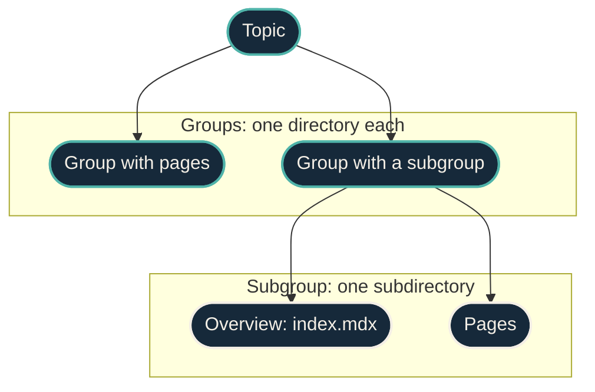

{/* projected from the authoring site; do not edit here */}
This page is the standard for every page on this site. When a page and a rule disagree, fix the page.
Each limit below comes from measured best-in-class docs or from usability research, not from habit.
The Basis column names the source.

The tables are generated from one data file, so this page never restates a number. A rule marked
**Hard** fails the build check. A **target** prints a warning. A **guideline** is checked in review.
A **planned** rule names the phase of the docs overhaul that turns it on.

## How the site is organized

The site is organized by **domain**, not by document type. A reader picks a topic, then a group,
then a page. The document type, in the [Diátaxis](https://diataxis.fr/) sense, is page metadata
(`page_type`), not a navigation level.

A page's URL is its directory, never its topic or group. So moving a group to another topic moves no
URL. Each directory is one sidebar group, and its `index.mdx` is the group's landing page.

{/*Shape: hierarchy. Topic -> 2 groups -> 2 pages in one subgroup.*/}
{/*Nodes: 5. Boundary crossings: 1 per edge. Aspect: ~4:3 TB. Pass.*/}

## Navigation

A fixed "seven items" cap is a myth. Menus rely on recognition, not recall, so the research
supports visible navigation, specific labels, a shallow tree, and short groups. The caps below are
the envelope that Claude Code's documentation keeps, counted from its page index.

| Id | Rule | Value | Level | Status | Basis |
| --- | --- | --- | --- | --- | --- |
| N0 | Every content directory sits in exactly one navigation group, and every navigation entry exists |  | Hard | Active |  |
| N1 | Topics in the site navigation | ≤9 (target ≤7) | Hard | Active | [Claude Code docs (counted 2026-11-04)](https://code.claude.com/docs/llms.txt) |
| N2 | Items in one topic | ≤10 (target ≤7) | Hard | Active | [Claude Code docs (counted 2026-11-04)](https://code.claude.com/docs/llms.txt), [UX Myths: the rule of seven](https://uxmyths.com/post/931925744/myth-23-choices-should-always-be-limited-to-seven) |
| N3 | Items in one sidebar group (pages and subgroups) | ≤10 (target ≤7) | Hard | Active | [Claude Code docs (counted 2026-11-04)](https://code.claude.com/docs/llms.txt), [NN/g: menu design](https://www.nngroup.com/articles/menu-design/) |
| N4 | Sidebar levels below a topic (group, subgroup, page) | ≤3 | Hard | Active | [Claude Code docs (counted 2026-11-04)](https://code.claude.com/docs/llms.txt), [NN/g: flat vs. deep](https://www.nngroup.com/articles/flat-vs-deep-hierarchy/) |
| N5 | A page's sidebar, with only its own path open, fits a viewport of | 1440x900 px | Hard | Planned (phase 2) | [NN/g: menu design](https://www.nngroup.com/articles/menu-design/) |
| N6 | Pages in a directory, besides its landing | ≥2 | Hard | Active | [NN/g: flat vs. deep](https://www.nngroup.com/articles/flat-vs-deep-hierarchy/) |
| N7 | Every directory lands on an index.mdx whose sidebar label is | `Overview` | Hard | Active | [Claude Code docs (counted 2026-11-04)](https://code.claude.com/docs/llms.txt) |
| N8 | Sidebar labels are unique among siblings and never repeat the parent's label |  | Hard | Active | [NN/g: menu design](https://www.nngroup.com/articles/menu-design/) |
| N9 | Lines one sidebar entry wraps to at 1440 px wide | ≤2 | Hard | Planned (phase 2) | [NN/g: menu design](https://www.nngroup.com/articles/menu-design/) |
| N10 | Rows in the "what do you want to do?" table that opens home and each topic landing | ≤10 | Guideline | Active | [Claude Code docs (counted 2026-11-04)](https://code.claude.com/docs/llms.txt), [NN/g: flat vs. deep](https://www.nngroup.com/articles/flat-vs-deep-hierarchy/) |

## Page types

Every page has one `page_type`. A path can imply the type, so a directory's `index.mdx` is always
an `overview`. A type sets what the page must contain.

| page_type | Use it for | It must contain | Implied by path |
| --- | --- | --- | --- |
| `overview` | A directory's landing page; the mental model and a map of its pages. | `<SectionIndex>` or `<Mermaid>` | `**/index.mdx` |
| `explanation` | How something works and why. |  |  |
| `how-to` | Steps to reach one goal. | `<Steps>` |  |
| `runbook` | Steps to change or recover a running system, with a check at each step. | `<Steps>`, `## Verify`, `## Roll back` |  |
| `troubleshooting` | One symptom, its cause, and the fix. | `## Symptoms`, `## Cause`, `## Fix` |  |
| `reference` | Facts to look up, such as tables, settings, or one host or service. |  |  |
| `decision` | A decision record (ADR) with its context and consequences. | `**Status:** line`, `## Context`, `## Decision`, `## Consequences`, `## Alternatives considered` | `decisions/*.mdx` |
| `repo` | One repository; what it owns, its contracts, and links to source. | `<RepoMeta>` |  |

## Pages

| Id | Rule | Value | Level | Status | Basis |
| --- | --- | --- | --- | --- | --- |
| P1 | Every page declares a page_type, or its path implies one |  | Hard | Active | [Diátaxis](https://diataxis.fr/), [GitLab topic types](https://docs.gitlab.com/development/documentation/topic_types/) |
| P2 | A page contains what its page_type requires |  | Hard | Active | [Good Docs Project](https://www.thegooddocsproject.dev/), [GitLab topic types](https://docs.gitlab.com/development/documentation/topic_types/) |
| P3 | Titles are unique site-wide and carry no status words or semicolons |  | Hard | Active | [Google style guide](https://developers.google.com/style) |
| P4 | Titles use sentence case; how-to and runbook titles start with a verb; only landings say Overview |  | Guideline | Active | [Google style guide](https://developers.google.com/style), [GitLab topic types](https://docs.gitlab.com/development/documentation/topic_types/) |
| P5 | Words in the description, which is one sentence | ≤25 | Hard | Active | [Google style guide](https://developers.google.com/style) |
| P6 | No hand-rolled or foreign markup: \ , ::: directives, and (on private pages) CardGrid cols and LinkCard icon |  | Hard | Active | [Starlight components](https://starlight.astro.build/components/using-components/) |
| P7 | The description is the lede, shown under the title; no blockquote before the first section |  | Hard | Active | [Claude Code docs (counted 2026-11-04)](https://code.claude.com/docs/llms.txt) |
| P8 | Heading levels in the body, with no level skipped | H2 to H3 (H4 on reference pages) | Hard | Active | [Claude Code docs (counted 2026-11-04)](https://code.claude.com/docs/llms.txt), [Google style guide](https://developers.google.com/style) |
| P9 | Words of body text per aside; never two asides in a row | ≥200 (target ≥500) | Hard | Active | [Claude Code docs (counted 2026-11-04)](https://code.claude.com/docs/llms.txt) |
| P10 | Next-step links (from related) that end overview, how-to, and runbook pages | ≤8 | Hard | Planned (phase 1) | [Claude Code docs (counted 2026-11-04)](https://code.claude.com/docs/llms.txt) |
| P11 | Diagrams use the Mermaid component and the site theme, with no fenced mermaid block and no %%\{init\} directive |  | Hard | Active | [Starlight components](https://starlight.astro.build/components/using-components/) |
| P15 | Diagrams color nodes with the house classes and define no classDef of their own |  | Hard | Active | [Starlight components](https://starlight.astro.build/components/using-components/) |
| P12 | Show OS or tool alternatives with \<Tabs>, not repeated headings |  | Guideline | Active | [Claude Code docs (counted 2026-11-04)](https://code.claude.com/docs/llms.txt) |
| P13 | Frontmatter uses only known keys |  | Hard | Active | [Starlight components](https://starlight.astro.build/components/using-components/) |
| P14 | Sidebar order is 0 on a landing and 1 on at most one other page; badges say only these words | `Draft`, `Stub` | Hard | Active | [Starlight components](https://starlight.astro.build/components/using-components/) |

### Titles and file names

| Surface | Rule |
| --- | --- |
| File name | Lowercase `kebab-case`. It **is** the URL slug, and the two never differ. |
| Landing page | `index.mdx`, with the sidebar label `Overview`. |
| Title | Sentence case: capitalize the first word and proper nouns only. Never a raw slug. |
| Ampersand | Use **"and"** in titles and labels. Keep `&` only inside an official product name. |

Keep these tokens exactly as written, wherever they appear in a title:

`AI · API · AWS · BMC · CI/CD · DNS · GPU · HEC · IAM · IaC · IDS · IPS · K8s ·
LLM · LXC · macOS · MCP · MFA · MLX · MoE · Nix · OIDC · OTEL · OTLP · PR ·
README · SIEM · SOPS · TTL · UniFi · VLAN · VMID · VPN · YAML · ZFS`, plus proper
nouns in their own casing: `Apple · Bifrost · ChatGPT · Cribl · Docker ·
GitHub · Kubernetes · Mac · OpenTofu · OrbStack · Proxmox · Splunk`

### Callouts

Each aside type has one meaning. Use `note` for context, and `tip` for a better way to do something.
Use `caution` when the text describes the target, not yet reality. Use `danger` only for an action
that destroys data or weakens security.

### Sidebar order and badges

Starlight lists ordered pages first, then the rest alphabetically. So a landing page takes
`sidebar.order: 0`, at most one other page takes `1`, and every other page stays unordered.

A sidebar badge marks **documentation** status only. Infrastructure status, such as live, declared,
or planned, belongs in the page's prose. See the status taxonomy.

### Writing style

Follow the [technical writing standard](https://github.com/dryvist/docs/blob/main/AGENTS.md#technical-writing):
short sentences, one idea each, active voice, and sentence-case headings. Define each term of art the
first time you use it.

For large approximate quantities, use lowercase `k` for thousands and uppercase `M` and `B` for
millions and billions. Use at most one decimal and no space: write `40k`, not `40,000`. Keep exact
values exact, such as dates, IDs, money totals, hours, and validated counts. Vale's `CompactNumbers`
rule flags the long form.

## Search

| Id | Rule | Value | Level | Status | Basis |
| --- | --- | --- | --- | --- | --- |
| S1 | Diagram source, page indexes, and site chrome stay out of the search index |  | Hard | Planned (phase 3) | [Pagefind weighting](https://pagefind.app/docs/weighting/) |
| S2 | Search filters by topic and page_type |  | Hard | Planned (phase 3) | [Pagefind weighting](https://pagefind.app/docs/weighting/) |
| S3 | Results within which a golden query finds its page | ≤3 | Hard | Planned (phase 3) | [Pagefind weighting](https://pagefind.app/docs/weighting/) |
| S4 | Keywords per page, for synonyms and acronyms only | ≤5 | Hard | Planned (phase 3) | [Pagefind weighting](https://pagefind.app/docs/weighting/) |

## Theme

| Id | Rule | Value | Level | Status | Basis |
| --- | --- | --- | --- | --- | --- |
| T1 | Colors and fonts are tokens in src/styles/custom.css; components hold no color values (diagrams follow P11) |  | Hard | Active | [WCAG 2.2 contrast](https://www.w3.org/TR/WCAG22/#contrast-minimum) |
| T2 | Text contrast ratio in both themes, for each text and background token pair | ≥4.5 | Hard | Active | [WCAG 2.2 contrast](https://www.w3.org/TR/WCAG22/#contrast-minimum) |
| T3 | Icons on private pages come from Starlight's built-in set (public pages may use the public site's icons) |  | Hard | Active | [Starlight components](https://starlight.astro.build/components/using-components/) |
| T4 | Font family names match the fontsource packages that load them |  | Hard | Active | [Starlight components](https://starlight.astro.build/components/using-components/) |

## URLs

A page that moves leaves a redirect at its old URL. A URL this site has served never stops resolving.

| Id | Rule | Value | Level | Status | Basis |
| --- | --- | --- | --- | --- | --- |
| U1 | Every URL the site has served still resolves to a page or a redirect |  | Hard | Active |  |

## How the rules are enforced

Hard rules run as automated checks on every change. A shrink-only baseline records the pages that
broke a rule when it turned on, so new pages follow every rule from day one. Older pages are fixed
section by section.

## Sources

| Source |
| --- |
| [Claude Code docs (counted 2026-11-04)](https://code.claude.com/docs/llms.txt) |
| [NN/g: menu design](https://www.nngroup.com/articles/menu-design/) |
| [NN/g: flat vs. deep](https://www.nngroup.com/articles/flat-vs-deep-hierarchy/) |
| [UX Myths: the rule of seven](https://uxmyths.com/post/931925744/myth-23-choices-should-always-be-limited-to-seven) |
| [Diátaxis](https://diataxis.fr/) |
| [GitLab topic types](https://docs.gitlab.com/development/documentation/topic_types/) |
| [Good Docs Project](https://www.thegooddocsproject.dev/) |
| [Google style guide](https://developers.google.com/style) |
| [Starlight components](https://starlight.astro.build/components/using-components/) |
| [Pagefind weighting](https://pagefind.app/docs/weighting/) |
| [WCAG 2.2 contrast](https://www.w3.org/TR/WCAG22/#contrast-minimum) |
