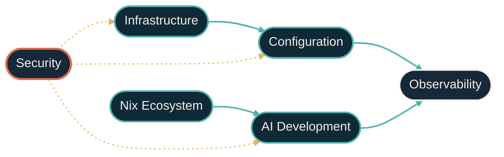

{/* projected from the authoring site; do not edit here */}
Forty repositories sound like a lot. Five public surfaces work together as one stack.

## The five public surfaces

<CardGroup cols={3}>
<Card
  title="Infrastructure"
  icon="server"
  href="/infrastructure/overview">
  OpenTofu · Ansible · Proxmox
</Card>
<Card
  title="Observability"
  icon="chart-line"
  href="/observability/overview">
  Cribl · Splunk · OTEL
</Card>
<Card
  title="Nix Ecosystem"
  icon="snowflake"
  href="/nix/overview">
  macOS host · user env · AI tooling · dev shells
</Card>
<Card
  title="AI Development"
  icon="robot"
  href="/ai-development/overview">
  Claude · Antigravity · Copilot · MLX
</Card>
<Card
  title="Dev Tools"
  icon="screwdriver-wrench"
  href="/tools/overview">
  Raycast · MLX bench · K8s
</Card>
</CardGroup>

The diagram shows security as a cross-cutting control for these surfaces.

## How they depend on each other

{/*Shape: parallel convergence. Two chains land on Observability. */}
{/* Security is the gate (dotted control edges). 6 nodes. Boundary crossings: 0.*/}

Two chains converge on Observability: the homelab chain (Infrastructure → Configuration) and the dev
chain (Nix → AI Development). Security (coral) gates the upstream end of each: credentials, branch
protection, isolation. Dotted amber edges are control, not data.

## Going deeper

<CardGroup cols={3}>
<Card
  title="Repository catalog"
  icon="folder-tree"
  href="/repositories">
  Every repo at a glance, grouped by surface.
</Card>
<Card
  title="Architecture"
  icon="sitemap"
  href="/architecture/overview">
  Data pipelines and AI pipeline narratives.
</Card>
</CardGroup>
