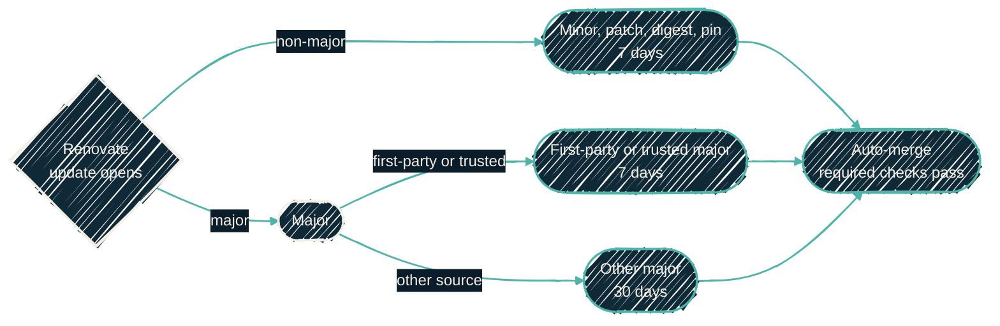

{/* projected from the authoring site; do not edit here */}
> Every Renovate update auto-merges once it clears its release age and the required checks pass.
> Majors from outside the trusted list wait 30 days; everything else waits 7. No Renovate update
> class waits for a person.

{/*Shape: decision tree, update kind routes to a lane. 6 nodes. Aspect ~3:1 LR.*/}

Every Renovate configuration extends `github>JacobPEvans/.github`; repositories with a Nix flake
also extend `:renovate-nix`. Shared rules live in [`renovate-presets.json`](https://github.com/JacobPEvans/.github/blob/main/renovate-presets.json).
Renovate opens PRs on weekends only.
[SECURITY.md](https://github.com/JacobPEvans/.github/blob/main/SECURITY.md) carries the same table from
the security angle. Dependabot handles security updates per repository; Renovate vulnerability alerts
are off.

## Release age by tier

The preset is the source of truth for every value below.

| Tier | Scope | Minor, patch, digest, pin | Majors |
| --- | --- | --- | --- |
| **First-party** | `dryvist/**`, `JacobPEvans/**`, `JacobPEvans-*/**`, `jpe-*/**` | 7 days | 7 days |
| **Trusted** | curated allowlist in `renovate-presets.json` | 7 days | 7 days, labeled `dep:review` |
| **Other** | everything else | 7 days | 30 days |

Every update auto-merges once it clears its release age and the required checks pass. No Renovate
update class waits for a person. The `dep:review` label runs the AI dependency review; it does not
hold the merge.

## Why these tiers

**Freshness first.** The default is to move, not to freeze. Stale dependencies build their own
risk: unpatched CVEs, drifting APIs, and harder upgrades later.

**Release age is a supply chain tripwire.** The xz backdoor was caught about three days after its
malicious release. npm allows unpublishing within 72 hours. A seven-day wait lets Renovate skip a
poisoned release. A major from outside the trusted list waits 30 days. Major releases can break
compatibility, and unfamiliar publishers add risk.

## First-party changes arrive by pull request

Inside the org, release-please opens a release pull request in the *source* repo and enables auto-merge
on it. On git-flow repos, whose default branch is `develop`, the release PR targets `develop` and the
release is tagged only when `develop` is promoted to `main`. After a release is published,
the reusable `promote-major-tag` workflow moves the floating `vN` tag. The tag may carry SemVer build
metadata (`vX.Y.Z+rev.1`); the workflow moves the floating tag for it too. Consumers pick up a change
only through a pull request that changes their ref or lock. A releasing repo may send a
`repository_dispatch` event carrying its name and tag. The consumer then relocks only the named input
and classifies the bump as patch, minor, or major from the release tags. The releasing repo's
`DISPATCH_CONSUMERS` repository variable lists the consumer repos that receive the event. Without a
dispatch, a lock revision that is still inside the floating tag's history counts as fresh, so no
scheduled run moves it. Producer releases never push a bump into a consumer.

## AI review is advisory, not the merge gate

Supply chain safety for the publisher-agnostic minor/patch lane comes from a deterministic gate, not
an AI judgment call.
[`actions/dependency-review-action`](https://github.com/actions/dependency-review-action) runs
inside the **Merge Gate**, a required, non-AI check on every public repo. It fails closed on
vulnerable or disallowed transitive dependencies before anything merges.

[`JacobPEvans/.github-ai` → `cc-dep-review.yml`](https://github.com/JacobPEvans/.github-ai) runs
separately, under its own **AI Merge Gate**, on every Renovate/Dependabot PR. This is the inverse
of the usual "skip dependency bots" rule. It is advisory only:

- Claude reviews the diff and changelog with an injection-resistant prompt. The review is read-only and uses no secrets. Claude applies a low, medium, or high risk label.
- The risk label adds context for review. It does not control auto-merge or replace the deterministic Merge Gate.
- The Merge Gate and the AI Merge Gate are always two distinct required checks on public repos. The AI signal never substitutes for the deterministic one.

## Grouping and scheduling

Related updates batch into ecosystem groups (Terraform, AWS SDK, HuggingFace, OpenTelemetry, pytest,
ESLint/TypeScript) plus a `.nix` version-pins group. One review then covers a coherent set instead
of a PR per package. All trusted updates land in the same Monday/Thursday window, the same day and
time across every repo. Renovate coordinates *schedules*, not cross-repo transactions. It cannot emit one
PR spanning multiple repos, so each repo still gets its own PR in that shared window.

## Nix flake locks are outside Renovate

`flake.lock` is the one file Renovate does not modify. Its `nix` manager is turned off org-wide. Each
nix repo instead calls a shared relock workflow, the only writer of `flake.lock`. The weekly scheduled
run moves every third-party input together, onto one branch, as one pull request, and skips dryvist
inputs. A `repository_dispatch` event, sent when an upstream dryvist repo releases, relocks only the
named input. Manual dispatch also triggers the workflow. All three amend the same pull request rather
than opening a second.

The reason is structural, not a preference. Renovate advances an input when the input's *reference*
changes. Nix repos pin `nixpkgs` to a moving channel branch, and that branch's reference never
changes; new commits simply land on the same branch. So Renovate has nothing to diff, and the
locked revision would freeze permanently. Advancing it needs `nix flake update`, which in Renovate
terms is `lockFileMaintenance`. That setting stays on for every other ecosystem. On nix it resolves
to absolute-latest, ignores `minimumReleaseAge`, and once looped roughly 60 pull requests a week.
Dryvist inputs pinned to a floating `vN` tag have the same blind spot. The reference text never
changes when a new release lands under that major. Only the dispatch path moves them.

Staleness here is expensive, not cosmetic. A pin that drifts off the Hydra-evaluated channel head
loses binary-cache coverage and forces builds from source. The workflow reports that drift by
comparing the locked revision against the published channel revision.

The workflow never auto-merges a pull request in which a `nixpkgs*` input moved, since a channel jump
rebuilds the world on a machine configuration. A third-party release bump of any other input still
merges hands-off on green CI. A dryvist patch bump merges hands-off once the Merge Gate is green. A
dryvist minor or major Nix lock bumps from release dispatch wait for a person; they are not Renovate
update classes.

## Version pinning

| Source | Pin |
| --- | --- |
| Central reusable workflows (GitHub Actions `uses:`) | Floating major tag: `JacobPEvans/.github/.github/workflows/<file>@v1` or `JacobPEvans/.github-ai/.github/workflows/<file>@v1` |
| dryvist Nix flake inputs, Ansible git sources, Tofu module sources | Floating major tag: `github:dryvist/<repo>?ref=vN` (Tofu: `?ref=vN`; Ansible: `version: vN`). The lock file holds the exact revision |
| Third-party GitHub Actions (trusted or untrusted) | Full commit SHA, with the released version tag as a trailing comment: `uses: actions/checkout@<sha> # v4.2.2` |

A `uses:` pin resolves its version tag automatically for Renovate and for anyone reading the diff. A
non-`uses:` pin (a container digest, a downloaded binary, anything Renovate can't infer the source
of) needs an explicit hint comment instead: `# renovate: datasource=... depName=... versioning=...`.

`platformAutomerge` stays **false**. GitHub's merge queue has a known bug where a PR passes every
check but the merge never executes, stalling for days. Renovate merges via its own API path with
retry instead. The per-scanner posture for dryvist references lives in [CI/CD
policy → scanner posture](/infrastructure/cicd/policy#scanner-posture-for-self-references).

## Pinning and bump policy

These rules cover dryvist-owned dependencies. Third-party dependencies keep the trust tiers defined earlier on this page.

1. **Central reusable workflow refs** use the floating major tag: `JacobPEvans/.github/.github/workflows/<file>@v1`
   or `JacobPEvans/.github-ai/.github/workflows/<file>@v1`, without a trailing version comment.
   Renovate keeps these refs on the major tag. Third-party action refs remain pinned to full commit SHAs.
2. **Nix flake inputs, Ansible git sources, and Tofu module sources** that point at a dryvist repo use the
   floating major tag: `github:dryvist/<repo>?ref=vN` (Tofu: `?ref=vN`; Ansible: `version: vN`). The lock
   file (`flake.lock`, `.terraform.lock.hcl`, the resolved requirements) holds the exact revision. A bump
   is a pull request that changes the ref or relocks, so CI builds the new version.
3. **Bumps are pull requests, never silent.** A bot opens one pull request per consumer that updates the
   ref or SHA and the lock. Renovate updates follow the trust-tier policy in the preceding section. Nix release-dispatch lock
   PRs follow the separate gate described in [Nix flake locks](#nix-flake-locks-are-outside-renovate).
   `nixpkgs*` moves never auto-merge. Nothing tracks `main`, `develop`, or "latest" of a dryvist repo.
   First-party digest and pin PRs carry no human-gate label: Renovate leaves them to the bot-PR
   auto-merge sweep, which merges each once its head commit has soaked and checks are green.
   `needs-human` is not a label in the organization.
4. **Release PRs (release-please) auto-merge** once their checks pass, in every repo the organization
   releases. git-flow repos (default branch `develop`) cut the release PR against `develop` and tag only when
   `develop` is promoted to `main`; nothing is merged back into `develop`. A repo behind the manual-review
   ruleset keeps the release PR open until the release App is a bypass actor on that ruleset.
5. **Floating major tags.** Every dryvist repo that other repos consume publishes a floating `vN` tag at
   its current major. The reusable `promote-major-tag` workflow moves it after a release is published. A
   major version bump (`feat!` or `BREAKING CHANGE`) needs explicit human intent. A repo whose releases
   follow an upstream version can cut a packaging-only release for a change to its own code: a Nix packaging repo
   tags `v{upstream version}+rev.{N}` from a manual run of its Auto Tag workflow on `main`. The tag push
   moves the floating tag and starts the consumer dispatch without waiting for the draft release.
6. **Producer releases do not push bumps.** A releasing repo may send a `repository_dispatch` event
   carrying its name and tag. The consumer relocks only the named input and classifies the bump (patch,
   minor, or major) from the release tags. Scheduled whole-lock relocks skip dryvist inputs.
7. **Deploys build from a pinned lock.** Host builds use the wrapper repo's `flake.lock`, whose dryvist
   inputs use `?ref=vN`. Nothing deploys from `main`.
8. **Enforcement.** zizmor allows first-party shared workflows to use floating major tags; third-party actions
   remain hash-pinned. `scripts/ci-gate-uses-resolve.sh` (`PIN_POLICY_MODE`) and `scripts/flake-lock-fresh.sh`
   (`FLAKE_REF_POLICY`) fail by default on refs that break rules 1 and 2; `warn` is still accepted. A flake ref
   may name a floating major tag (`vN`) or an exact release tag (`vX.Y.Z`). The `uses:` scan covers alias,
   flow-style and quoted-key entries in workflows and in every `action.yml`; shared workflow refs use `@v1`.
   Two exceptions sit outside the checks: the `.github` canary raw fetch at `main`, and
   checkouts of repos a workflow writes to, such as docs repos and the model registry. Source:
   [JacobPEvans/.github#372](https://github.com/JacobPEvans/.github/pull/372).
9. **Third-party dependencies are unchanged** by this policy.

## Where to go next

<CardGroup cols={2}>
<Card
  title="CI/CD policy"
  icon="scale-balanced"
  href="/infrastructure/cicd/policy">
  Marketplace actions, release-please conventions, the scanner posture for dryvist self-references, the runner-label catalog.
</Card>
<Card
  title="AI workflows"
  icon="robot"
  href="/automation/repos/ai-workflows">
  The reusable workflows behind the AI dependency reviewer and the App-token signing they use.
</Card>
</CardGroup>
