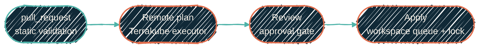

{/* projected from the authoring site; do not edit here */}
> CI validates code. Terrakube plans, locks, and applies OpenTofu inside the homelab.

{/*Shape: linear pipeline, 4 stages. 4 nodes. Aspect ~3:1 LR.*/}

The GitHub Actions runner fleets page owns runner tiers, labels, and routing. Credentialed OpenTofu runs are a separate control-plane concern owned by Terrakube.

## The shape of every IaC pipeline

| Stage | Trigger | Where it runs | What it does |
| --- | --- | --- | --- |
| Static validation | `pull_request` | The repo's CI tier | `tofu fmt -check`, `tofu init -backend=false`, `tofu validate`, and tests without live credentials |
| Remote plan | VCS or operator trigger | Homelab Terrakube executor | Keeps resolved values in the workspace log |
| Review | Terrakube approval step or explicit saved-plan gate | Terrakube UI / operator command-line tool | Reviews the complete plan and blocks unexpected destroy or replacement |
| Apply | Approved Terrakube run | Same workspace executor | Applies under the workspace's native queue and state lock |

Public PRs never receive raw resolved plans. Terrakube keeps the full plan in the homelab workspace.

## Branch protection and merge rules

Current branch rules and the required merge gate are documented in [CI/CD policy](/infrastructure/cicd/policy).

## Where to go next

<CardGroup cols={2}>
<Card
  title="Dependency automation"
  icon="rotate"
  href="/infrastructure/cicd/dependency-automation">
  Renovate trust tiers, scheduling, automerge policy, and version-pinning across every repo.
</Card>
<Card
  title="CI/CD policy"
  icon="scale-balanced"
  href="/infrastructure/cicd/policy">
  Shared workflows, release checks, and the required merge gate.
</Card>
<Card
  title="Git signing"
  icon="signature"
  href="/infrastructure/cicd/git-signing">
  Identity per execution context, the App-token pattern, deterministic-GHA signing.
</Card>
<Card
  title="OpenTofu check placement"
  icon="list-check"
  href="/infrastructure/tofu-check-placement">
  Static checks in pre-commit and CI; credentialed operations in Terrakube.
</Card>
<Card
  title="Infrastructure overview"
  icon="server"
  href="/infrastructure/overview">
  Where CI/CD fits in the broader Proxmox + AWS picture.
</Card>
</CardGroup>
