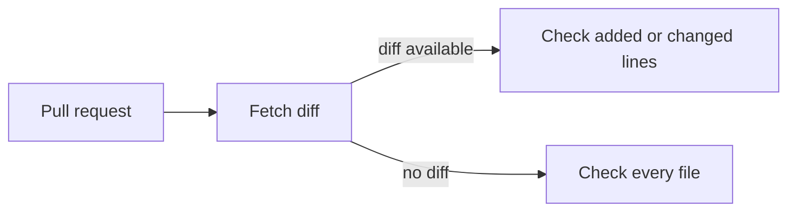

{/* projected from the authoring site; do not edit here */}
{/*TIER-GUARD: reference page — runner catalogs and release rules need to live together.*/}

> The CI tier is whatever the workload actually needs. Build it from marketplace actions, version-pin every dependency, and treat releases as permanent.

{/*Shape: linear release lifecycle. 3 nodes. Aspect ~3:1 LR.*/}

The policy on this page applies to every workflow under `JacobPEvans/*` and `dryvist/*`. The
companion page [`git-signing`](/infrastructure/cicd/git-signing) covers identity and
signed-commit attribution. This page covers everything else.

## Prefer native CI/CD constructs

| Task | Use this | Not this |
| --- | --- | --- |
| CI/CD automation | Marketplace actions, reusable workflows, composite actions | Custom shell script |
| GitHub Actions logic | Expressions, `fromJSON()`, matrix strategies | Python or bash in a `run:` step |

Scripts belong in dedicated files (`.github/scripts/*.sh`, `scripts/*.py`), not inlined into YAML. See [No scripts in non-script files](/conventions/no-scripts) for the full rule.

## GitHub Releases

Treat published releases as permanent. Once a release is promoted from draft to published, do not
modify or delete it, ever. GitHub technically allows edits and deletions. The policy here forbids
it. If a correction is needed, create a new release.

- Open releases as **drafts** until fully complete (all assets uploaded, notes finalized).
- Promote draft to published only when everything is ready.
- Every repo uses [release-please](https://github.com/googleapis/release-please) for automated version bumps:
  - **Patch** bumps come from `fix:` commits
  - **Minor** bumps come from `feat:` commits
  - **Major** bumps are **human-initiated only**: edit `.release-please-manifest.json` manually. The release workflow blocks automated major bumps, including from `BREAKING CHANGE:` footers
  - **Release PRs** are never auto-merged. A person merges each one when the batch of changes is ready.
- Conventional-commit style preference:
  - `fix:` for config tweaks, small improvements, incremental adjustments, dependency updates
  - `feat:` reserved for genuinely new capabilities, integrations, or significant behavioral changes
- See [Reusable workflow ownership](#reusable-workflow-ownership) for the shared source.

`JacobPEvans/.github` includes `ci:` commits in release highlights because
reusable workflows are that repo's product; its release-please `ci` section is
no longer hidden.

Conventional Commits and the no-emoji rule for commit subjects live in [Commit conventions](/conventions/commit-conventions).

## Dependency versioning

See [Dependency automation](/infrastructure/cicd/dependency-automation) for the shared Renovate
source, update schedule, grouping, security alerts, and flake-lock policy.

### Scanner posture for self-references

First-party references (any enterprise-owned organization) float on `@vN`. Third-party actions must use a full commit SHA with a trailing
`# vX.Y.Z` comment. The enterprise `Workflow Policy` check enforces this rule.
`pinact run` pins action references, so revert any first-party line it pins to
keep that `@vN` ref floating.

Nix, Ansible, and Tofu sources use a floating major tag (`?ref=vN`), and the
lock file holds the exact revision.
The org scanners enforce that shape:

- **Renovate.** Keeps shared workflow refs on the `@v1` major tag.
- **zizmor.** Allows first-party shared workflows to use floating major tags; third-party actions remain hash-pinned.
- **Merge Gate.** Resolves shared workflow refs and fails if the referenced workflow is unavailable. The source is in
  [Dependency automation](/infrastructure/cicd/dependency-automation).
- **CodeQL.** Code scanning default setup on public repos only (free; private repos excluded to
  avoid the paid Code Security charge), managed as IaC in
  [`tofu-github`](/infrastructure/repos/tofu-github) (per-repo, pending the provider resource).
  No committed query-filter config.
- **OSV-Scanner.** Reports dependency vulnerabilities, not ref pinning.

The full per-scanner posture lives in [`JacobPEvans/.github`
→ SECURITY.md](https://github.com/JacobPEvans/.github/blob/main/SECURITY.md).

## Reusable workflow ownership

Reusable GitHub Actions workflows are referenced by a literal `owner/repo` in `uses:`. GitHub
allows no variables there, and it does not follow repository move or rename redirects for those
references. So when a shared-CI repository changes ownership, every consumer must update its
`uses:` reference at the same time.

The shared `_release-please.yml` job uses the concurrency group
`release-please-<repo>-<ref>` with `cancel-in-progress: false`. It shipped in
v1.25.1, and the `v1` tag now points to that release.

See [Dependency automation](/infrastructure/cicd/dependency-automation) for the current shared
workflow source and consumer config rules.

### Workflow Policy

On a pull request, `Workflow Policy` fetches the PR diff and passes it to
[`pr-policy.py`](https://github.com/JacobPEvans/.github/blob/main/scripts/pr-policy.py)
with `--diff`. It reports violations only on lines the PR adds or changes. If no
diff is available, it checks every file. The workflow lives in
[`pr-policy.yml`](https://github.com/JacobPEvans/.github/blob/main/.github/workflows/pr-policy.yml).

## Runner choice

RunsOn (AWS EC2 spot via [`tofu-runs-on`](/infrastructure/cicd/tofu-runs-on)) is the default for
Linux jobs. The control plane carries a small fixed monthly cost regardless of job volume. Once it
is paid for, workflows that stay on `ubuntu-latest` spend GitHub Actions minutes that do not need to
be spent.

On-prem self-hosted is the documented exception for jobs that genuinely need local hardware. It is not a routine choice.

| Workload | Runner |
| --- | --- |
| Linux job (lint, validate, build, test) | RunsOn: `runs-on=${{ github.run_id }}/runner=2cpu-linux-x64` |
| Nix `flake check` (Linux) | RunsOn with more RAM: `runs-on=${{ github.run_id }}/cpu=4/ram=16/family=m7+c7/extras=s3-cache` |
| `macos-latest` | GitHub-hosted: RunsOn EC2 Mac has a 24-hour minimum allocation. For short jobs `macos-latest` is cheaper despite the 10× billing multiplier |
| `windows-latest` | RunsOn: supports Windows, case-by-case |
| Disabled-schedule workflow (manual `workflow_dispatch` only) | GitHub-hosted: migration saves nothing |
| Job requiring the always-on Mac Studio (LAN, local MLX, Apple-container Linux ARM64) | **mac-fleet**: `[self-hosted, Linux, ARM64, apple-container]`. GitHub runner group is still named `llm-runners`. This is **not** `macos-latest` and **not** the laptop |
| Job requiring OrbStack on a powered-on laptop | **on-prem self-hosted**: `[self-hosted, Linux, ARM64]` in `orbstack-kubernetes`. Do not confuse with mac-fleet |
| Job requiring Proxmox LAN / Docker on the homelab Linux x64 runner host | **proxmox-fleet**: `[self-hosted, Linux, X64, proxmox]` (`ansible-proxmox-apps`). See "On-prem runner requirements" below |

The leading `runs-on=${{ github.run_id }}` segment is **required** so the RunsOn control plane can
correlate the GitHub Actions `workflow_job` webhook back to the originating run. Without it, the
job hangs in `queued`. The shared reusable workflows accept a `runner_label` input (default
`ubuntu-latest`). Callers opt in by passing the RunsOn label string.

Full RunsOn label catalog, prereqs (GitHub App allowlist), rollout playbook, and verification steps
live in
[`tofu-runs-on/docs/migration-guide.md`](https://github.com/dryvist/tofu-runs-on/blob/main/docs/migration-guide.md).

### Ansible checks

Every Ansible repository calls `JacobPEvans/.github` for lint, change detection, and Molecule selection.
Pull requests into `develop` and `main` run lint, syntax, and repository contract checks, plus Molecule
scenarios mapped to changed paths. Non-main branch pushes use the same focused selection. Declared
full-matrix paths defer Molecule to the post-merge push to `main`; only that push runs the full matrix
and configured integration checks. Unmapped changes under `.github/` select no scenario; a caller runs
the full set for one by mapping it into every scenario filter. Other unmapped changes fail selection
instead of widening to all scenarios. Each caller's single `Merge Gate` requires Molecule and every
repository-specific check.
Public repositories and fork pull requests use GitHub-hosted runners. Eligible private repositories
may pass an approved self-hosted or RunsOn runner label. A role without a Molecule scenario may use
`molecule_contract_filters` only when its contract test runs inside that same `Merge Gate`.

Set job concurrency from measured runner capacity. Reassess the limit after
measuring peak CPU and memory use.

### Shared Molecule workflow

The reusable [`_molecule.yml@v1` workflow](https://github.com/JacobPEvans/.github/blob/main/.github/workflows/_molecule.yml)
runs the caller repository's Molecule scenarios. The caller owns scenario filters, required gates,
and repository-specific checks. All `workflow_call` inputs are optional; the source defines their
types and defaults.

- **Scenario discovery:** `scenarios`, `full_suite`, `scenario_discovery`,
  `scenario_discovery_script`, `scenario_name_profile`, `scenario_require_molecule_yml`.
- **Caller checks and setup:** `preflight_command`, `static_checks`, `pre_steps_script`, `extra_env`.
- **Runner and limits:** `discover_runner`, `runner_label`, `public_and_fork_hosted`,
  `discover_timeout_minutes`, `pull_request_discover_timeout_minutes`, `timeout_minutes`,
  `pull_request_timeout_minutes`, `scenario_timeout_floors`, `fail_fast`, `max_parallel`,
  `serialize_scenario`.
- **Python and Ansible Galaxy:** `python_version`, `python_install_mode`, `requirements_files`,
  `uv_cache`, `ansible_home_mode`, `molecule_roles_path`, `galaxy_cache_enabled`,
  `galaxy_cache_prefix`, `galaxy_cache_restore_prefix`, `galaxy_install_mode`,
  `galaxy_install_script`, `galaxy_force_install`, `galaxy_retry_attempts`,
  `galaxy_retry_wait_seconds`, `galaxy_step_timeout_minutes`, `galaxy_server_timeout_seconds`,
  `galaxy_refresh_contracts_v5`.
- **Molecule runtime:** `docker_timeout_seconds`, `docker_prune`, `nix_scenarios`, `molecule_args`,
  `molecule_workdir_mode`, `molecule_scenario_arg`, `instance_suffix`,
  `isolate_ephemeral_directory`.
- **Test credentials:** `doppler_enabled`, `test_secret_env_map`, `use_homarr_token`.

The test command stays fixed at `molecule test -s "$MOLECULE_SCENARIO"`, with optional Molecule
arguments appended as argv. Only explicitly mapped Doppler outputs reach the final Molecule step.

### Shared CI gate

The shared `_ci-gate.yml` workflow in `JacobPEvans/.github` applies the rules below to every caller.

- **Fork pull requests.** Every caller-selected `runs-on` and `runner_label` in `_ci-gate.yml` and `_ansible-ci.yml`
  resolves to `ubuntu-24.04` when the event payload carries a pull request from another repository. That includes
  `pull_request_target`.
- **Release-please metadata.** `VERSION`, `.release-please-manifest.json` and `release-please-config.json` are not
  unmapped paths, as Markdown files are not. A change that touches only these files emits no warning and sets `full=false`.
- **Python profile.** The `requirements*.txt` filter matches at any depth (`**/requirements*.txt`).
- **Queue watchdog.** The `watchdog` job watches every sibling job until each one completes. It cancels the run when
  a job in `queued`, `pending` or `requested` has waited longer than `queue_timeout_minutes`, measured from that job's
  creation time. It stops watching after `WATCH_MAX_MINUTES` (default 55) and exits 0 without cancelling. The job's
  timeout is 60 minutes. Jobs waiting for environment approval are never cancelled. The `Queue Watchdog` and
  `Merge Gate` jobs are exempt, including the prefixed names that called workflows give them.

### Flake input freshness

The reusable [`_flake-lock-fresh.yml` workflow](https://github.com/dryvist/.github/blob/main/.github/workflows/_flake-lock-fresh.yml)
accepts `runner_label` and the numeric `max_age_days` input. `max_age_days` defaults to `0`, which
disables the age check for root GitHub inputs; the owned-input freshness check still runs. Set
`max_age_days: 30` to check for updates older than 30 days on each locked ref.

### On-prem runner requirements

On-prem self-hosted runners are a single point of failure when the job has E2E coverage and the runner is broken or stale. Every on-prem runner must:

1. **Authenticate via a GitHub App** (`APP_ID` + `APP_PRIVATE_KEY`), never a personal access token.
2. **Pin the runner image (or VM template) by digest**, with Renovate tracking the digest. No floating tags.
3. **Expose a process-level healthcheck** (Docker `healthcheck:`, systemd `WatchdogSec`, or equivalent) so failed state surfaces in standard inspection tools.
4. **Emit a periodic heartbeat** to a dead-man's-switch endpoint (healthchecks.io or equivalent) so silent death pages someone.
5. **Check required environment variables** so the workflow fails when any are missing.
6. **Build the runner image off-node.** Build it on a dedicated build host and `docker load` it
   onto the runner host. Never build it in-place on a hypervisor node. A heavy image build can
   overload the node that also runs production guests.

Reference implementation: `orbstack-kubernetes/docker/actions-runner/`. See that repo's `Makefile` `runner-*` targets and `TESTING.md`.

## Where to go next

<CardGroup cols={2}>
<Card
  title="Git signing"
  icon="signature"
  href="/infrastructure/cicd/git-signing">
  Identity per execution context and the App-token pattern that signs every AI-authored commit.
</Card>
<Card
  title="tofu-runs-on"
  icon="play"
  href="/infrastructure/cicd/tofu-runs-on">
  The RunsOn runner pool itself — provisioning, OIDC trust, migration guide.
</Card>
<Card
  title="OpenTofu check placement"
  icon="list-check"
  href="/infrastructure/tofu-check-placement">
  Static checks in pre-commit and CI; remote plans and applies.
</Card>
<Card
  title="CI/CD overview"
  icon="server"
  href="/infrastructure/cicd/overview">
  Runner tiers in context, plan/apply gating, branch rulesets.
</Card>
</CardGroup>
