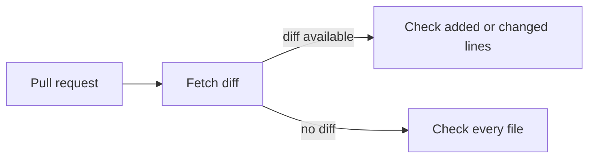

{/* projected from the authoring site; do not edit here */}
{/*Shape: linear release lifecycle. 3 nodes. Aspect ~3:1 LR.*/}

```mermaid
%%{init: {"theme":"base","look":"handDrawn","themeVariables":{"primaryColor":"#123a36","primaryTextColor":"#f4efe6","primaryBorderColor":"#4fb3a9","lineColor":"#4fb3a9","secondaryColor":"#0b1d2a","tertiaryColor":"#16293a","clusterBkg":"#08151f","clusterBorder":"#4fb3a9","fontFamily":"'Geist Sans', system-ui, -apple-system, BlinkMacSystemFont, 'Segoe UI', Roboto, sans-serif","fontSize":"14px"}}}%%
flowchart LR
  classDef src fill:#16293a,stroke:#e06b4a,stroke-width:2px,color:#f4efe6;
  classDef ai fill:#16293a,stroke:#e06b4a,stroke-width:2px,color:#f4efe6;
  classDef gate fill:#16293a,stroke:#e06b4a,stroke-width:2.5px,color:#f4efe6;
  classDef hop fill:#16293a,stroke:#4fb3a9,stroke-width:2px,color:#f4efe6;
  classDef host fill:#16293a,stroke:#4fb3a9,stroke-width:2px,color:#f4efe6;
  classDef sink fill:#16293a,stroke:#f4efe6,stroke-width:2px,color:#f4efe6;
  classDef auto fill:#16293a,stroke:#f4efe6,stroke-width:1.5px,color:#f4efe6;
  classDef external fill:#16293a,stroke:#e6b35a,stroke-width:2px,color:#f4efe6;
  Commit([fix: / feat: commit])
  Release([release-please<br/>opens the release pull request])
  Published([Published release<br/>permanent, never edited])

  Commit --> Release --> Published

  classDef step fill:#102937,stroke:#4FB3A9,stroke-width:2px,color:#F4EFE6;
  classDef done fill:#102937,stroke:#E06B4A,stroke-width:2px,color:#F4EFE6;

  class Commit,Release step
  class Published done

  linkStyle default stroke:#4FB3A9,stroke-width:1.5px;
```

The policy on this page applies to every workflow under `JacobPEvans/*` and `dryvist/*`. The
companion page [`git-signing`](/infrastructure/cicd/git-signing) covers identity and
signed-commit attribution. This page covers everything else.

## What runs when

| Stage | Hot repository | Standard repository |
| --- | --- | --- |
| Pull request push | Fast checks; `DEFERRED` verdict for tiny and land-first; verdict for normal and guarded; mapped bot checks; preflight may run heavy checks. | Fast checks; `DEFERRED` verdict for tiny and land-first; verdict for normal and guarded; mapped heavy checks for normal and bot; full suite for guarded. |
| Merge queue | Heavy checks once on the merged result; verifies the pull request head verdict without a model call. | Not used |
| After merge | Heavy checks and review for tiny and land-first; post-merge workflow settles deferred items. | Heavy checks and review for tiny and land-first; post-merge workflow settles deferred items. |
| Nightly | Full matrix and end-to-end tests on branch `green`. | Full matrix and end-to-end tests on branch `green`. |
| Promotion pull request | Light checks; verifies the full-suite result for its head commit. | Light checks; verifies the full-suite result for its head commit. |
| Release pull request | Mapped bot checks; no heavy checks. | Mapped bot checks; no heavy checks. |

## Fast checks

Fast checks finish in under 2 minutes. They include the secret scan, the disclosure scan, lint,
pull request title, and policy. The secret scan and the disclosure scan run first in every lane.

## Heavy checks

Heavy checks run on pull requests for standard repositories and in the merge queue for hot repositories. On hot repositories, the `preflight` label runs heavy checks early on the pull request.

- **tiny and land-first:** Fast checks run before merge. Heavy checks and review run after merge, and the gate adds `checks:deferred`.
- **normal:** Heavy checks map to changed paths.
- **guarded:** The full suite runs.
- **bot:** Checks map to changed files; no verdict runs.

Heavy checks never run on release pull requests, promotion pull requests, label events, or comment events.

## Deferred checks and the branch green

On every push to the default branch, the post-merge workflow settles what the fast lanes deferred.
The branch [green](/conventions/branch-conventions#the-branch-green) points at the newest commit of the default branch whose deferred checks and reviews have passed.

1. With no deferred pull request since `green`, `green` moves to the new head at once.
2. Otherwise, the heavy checks for everything changed since `green` run on the new head.
3. Each deferred pull request needs a `MERGE` verdict.
4. Then `green` moves.

If they fail:

- A message goes to the team chat at once.
- The CI-fix agent starts.
- After 15 minutes, a revert pull request is opened with `gh pr revert` (label `auto-revert`) and
  lands through the bot lane.

A `CHANGES` verdict after merge reverts at once. `green` only moves forward, and only the
automation App moves it. Deploys, pin bumps, and promotion read `green`, so a red default branch
never deploys and never spreads.

## Required checks

Required status checks on the default branch are `gate / Merge Gate` and `AI Merge Gate`.

The `AI Merge Gate` check runs on the pull request head and is posted by the reviewer App. The
ruleset accepts the check only from that App. The reviewer model comes from a different model
family than the author. The author family comes from the bot identity or from the `Assisted-by`
commit trailer, which pull request policy requires on agent pull requests.

In the queue, the verdict job makes no model call; it checks that the entry's pull request head has
its verdict.

## Releases

Treat published releases as permanent. Once a release is promoted from draft to published, do not
modify or delete it, ever. GitHub technically allows edits and deletions. The policy here forbids
it. If a correction is needed, create a new release.

- Open releases as **drafts** until fully complete (all assets uploaded, notes finalized).
- Promote draft to published only when everything is ready.
- Every repo uses [release-please](https://github.com/googleapis/release-please) for automated
  version bumps:
  - **Patch** bumps come from `fix:` commits
  - **Minor** bumps come from `feat:` commits
  - **Major** bumps are **human-initiated only**: edit `.release-please-manifest.json` manually. The
    release workflow blocks automated major bumps, including from `BREAKING CHANGE:` footers
  - **Release PRs** target the default branch and auto-merge through the bot lane after required checks pass. The
    [release-please workflow](https://github.com/JacobPEvans/.github/blob/v1/.github/workflows/_release-please.yml) opens them.
  - Tags are on `main`; a person makes major releases.
- Conventional-commit style preference:
  - `fix:` for config tweaks, small improvements, incremental adjustments, dependency updates
  - `feat:` reserved for genuinely new capabilities, integrations, or significant behavioral changes
- See [Reusable workflow ownership](#reusable-workflow-ownership) for the shared source.

`JacobPEvans/.github` includes `ci:` commits in release highlights because reusable workflows are that repo's product.

Conventional Commits and the no-emoji rule for commit subjects live in
[Commit conventions](/conventions/commit-conventions).

## CI cost rules

- **Concurrency:** Cancels superseded pull request runs; it never cancels queue runs or
  default-branch runs.
- **Matrix:** Pull request matrices are small (oldest and newest Python; Linux only for Nix). The full matrix and end-to-end tests run in the nightly full suite on branch `green`.
- **Cache:** The shared Molecule workflow exposes `galaxy_cache_enabled`, `galaxy_cache_prefix`, and `galaxy_cache_restore_prefix` controls.
- **Aggregate:** The gate aggregate uses the maintained action `re-actors/alls-green`: a mapped job that is skipped fails the gate.

## Prefer native CI/CD constructs

| Task | Use this | Not this |
| --- | --- | --- |
| CI/CD automation | Marketplace actions, reusable workflows, composite actions | Custom shell script |
| GitHub Actions logic | Expressions, `fromJSON()`, matrix strategies | Python or bash in a `run:` step |

Scripts belong in dedicated files (`.github/scripts/*.sh`, `scripts/*.py`), not inlined into YAML.
See [No scripts in non-script files](/conventions/no-scripts) for the full rule.

## Required merge gate

See [Required checks](#required-checks) for the two required checks.

Pull request arming, holds, and merge behavior are documented in [PR conventions](/conventions/pr-conventions).

## Public projection destination rulesets

## Dependency versioning

Shared dependency scanning, pin policy for actions and sources, Renovate policy, and flake-lock
updates live in
[Dependency automation](/infrastructure/cicd/dependency-automation).

## Reusable workflow ownership

Reusable GitHub Actions workflows are referenced by a literal `owner/repo` in `uses:`. GitHub
allows no variables there, and it does not follow repository move or rename redirects for those
references. So when a shared-CI repository changes ownership, every consumer must update its
`uses:` reference at the same time.

The shared [`_release-please.yml` workflow](https://github.com/JacobPEvans/.github/blob/v1/.github/workflows/_release-please.yml)
uses the concurrency group `release-please-<repo>-<ref>` with
`cancel-in-progress: false`. On a push to `develop` whose head commit message
starts with `chore(develop): release`, the release-please job does not run. A
different head message does not match the skip.

The shared `_tofu-ci.yml` workflow passes `GITHUB_TOKEN` to TFLint plugin
initialization.

See [Dependency automation](/infrastructure/cicd/dependency-automation) for the current shared
workflow source and consumer config rules.

### Workflow Policy

On a pull request, `Workflow Policy` fetches the PR diff and passes it to
[`pr-policy.py`](https://github.com/JacobPEvans/.github/blob/main/scripts/pr-policy.py)
with `--diff`. It reports violations only on lines the PR adds or changes. If no
diff is available, it checks every file. The workflow lives in
[`pr-policy.yml`](https://github.com/JacobPEvans/.github/blob/main/.github/workflows/pr-policy.yml).

## Runner choice

Runner selection follows the private pool rule: it admits public repositories only for shared gate and
post-merge workflows, and only merge queue jobs select it. Public repository pull request jobs use hosted
runners.

### Ansible checks

Every Ansible repository calls `JacobPEvans/.github` for lint, change detection, and Molecule selection. The
selector maps Molecule checks to changed paths. Heavy checks run on pull requests for standard repositories
and in the merge queue for hot repositories; `preflight` can run them early on hot repositories.

The selector fails closed on an unmapped path. An unmapped `.github/` path may
select no scenario. To get full coverage for such a path, a caller maps it into
every scenario filter. Required contracts and selected Molecule scenarios stay
inside the same `Merge Gate`. Selector, contract, or required-check failures
fail that gate. A role without a Molecule scenario may use
`molecule_contract_filters` only when its contract test runs inside the gate.

Promotion pull requests run light checks and verify the full-suite result for their head commit. The full suite runs on branch `green` before promotion.

On normal and guarded changes, Data Contract selects scope from the event and runs independently from shared
lint. The Merge Gate waits for contract, shared CI, and selected Molecule results. `ansible-proxmox-apps` maps
its dependency manifest and contract workflows to required contract jobs; its local Molecule harness uses the
default smoke scenario.

The `_lane.yml` classifier sets each pull request's lane from its files, size, labels, and author. Ansible scenario selection maps heavy checks to changed paths; guarded changes run the full suite.

The `ansible-proxmox-ai` router contract uses bounded batches and retains
every declared playbook. Its selector derives groups from the manifest and
selects full groups for changed playbooks. Each playbook runs in a fresh
`ansible-playbook` process. A repository guard checks coverage and process
isolation. Before the contract jobs, a lock step resolves the router's hashed
requirements with `uv` for the router guest's Python on x86_64. Conflicting pins
fail the pull request. See the [router contract workflow](https://github.com/dryvist/ansible-proxmox-ai/blob/da2f6a837b178b0a80a58f3a0618fbb4bd9b883f/.github/workflows/_llm-router-contract.yml),
[scope selector](https://github.com/dryvist/ansible-proxmox-ai/blob/da2f6a837b178b0a80a58f3a0618fbb4bd9b883f/.github/scripts/select-contract-scope.py),
and [batch guard](https://github.com/dryvist/ansible-proxmox-ai/blob/da2f6a837b178b0a80a58f3a0618fbb4bd9b883f/tests/repo_guards/test_router_contract_batches.py).

The shared workflow does not widen checks because a pull request targets
`main`. Local Molecule workflows consume the shared scope output or derive
role coverage from the repository tree. Queue time counts toward wall time.
Compare queue and execution durations instead of skipped-job counts.

### Shared Molecule workflow

The reusable [`_molecule.yml@v1` workflow](https://github.com/JacobPEvans/.github/blob/main/.github/workflows/_molecule.yml)
runs the caller repository's Molecule scenarios. The caller owns scenario filters, required gates,
and repository-specific checks. All `workflow_call` inputs are optional; the source defines their
types and defaults.

- **Scenario discovery:** `scenarios`, `full_suite`, `scenario_discovery`,
  `scenario_discovery_script`, `scenario_name_profile`, `scenario_require_molecule_yml`.
- **Caller checks and setup:** `preflight_command`, `static_checks`, `pre_steps_script`, `extra_env`.
- **Discovery limits:** `discover_timeout_minutes`, `pull_request_discover_timeout_minutes`,
  `timeout_minutes`,
  `pull_request_timeout_minutes`, `scenario_timeout_floors`, `fail_fast`, `max_parallel`,
  `serialize_scenario`.
- **Python and Ansible Galaxy:** `python_version`, `python_install_mode`, `requirements_files`,
  `uv_cache`, `ansible_home_mode`, `molecule_roles_path`, `galaxy_cache_enabled`,
  `galaxy_cache_prefix`, `galaxy_cache_restore_prefix`, `galaxy_install_mode`,
  `galaxy_install_script`, `galaxy_force_install`, `galaxy_retry_attempts`,
  `galaxy_retry_wait_seconds`, `galaxy_step_timeout_minutes`, `galaxy_server_timeout_seconds`,
  `galaxy_refresh_contracts_v5`.
- **Molecule runtime:** `docker_timeout_seconds`, `docker_prune`, `nix_scenarios`, `molecule_args`,
  `molecule_workdir_mode`, `molecule_scenario_arg`, `instance_suffix`,
  `isolate_ephemeral_directory`.
- **Runners:** the runner inputs follow the rule under [Runner choice](#runner-choice).
- **Test credentials:** `doppler_enabled`, `test_secret_env_map`, `use_homarr_token`.

The test command stays fixed at `molecule test -s "$MOLECULE_SCENARIO"`, with optional Molecule
arguments appended as argv. Only explicitly mapped Doppler outputs reach the final Molecule step.

### Shared CI gate

The shared `_ci-gate.yml` workflow in `JacobPEvans/.github` applies the rules below to every
caller.

- **Release-please metadata.** `VERSION`, `.release-please-manifest.json` and
  `release-please-config.json` are not
  unmapped paths, as Markdown files are not. A change that touches only these files emits no warning
  and sets `full=false`.
- **Python profile.** The `requirements*.txt` filter matches at any depth
  (`**/requirements*.txt`).
- **Queue watchdog.** The `watchdog` job watches every sibling job until each one completes. It
  cancels the run when
  a job in `queued`, `pending` or `requested` has waited longer than `queue_timeout_minutes`,
  measured from that job's
  creation time. It stops watching after `WATCH_MAX_MINUTES` (default 55) and exits 0 without
  cancelling. The job's
  timeout is 60 minutes. Jobs waiting for environment approval are never cancelled. The `Queue
  Watchdog` and
  `Merge Gate` jobs are exempt, including the prefixed names that called workflows give them.

### Flake input freshness

The reusable [`_flake-lock-fresh.yml` workflow](https://github.com/JacobPEvans/.github/blob/main/.github/workflows/_flake-lock-fresh.yml)
accepts the numeric `max_age_days` input. `max_age_days` defaults to `0`, which disables the age
check for root GitHub
inputs; the owned-input freshness check still runs. Set `max_age_days: 30` to check for updates
older
than 30 days on each locked ref.

The shared `_ci-gate.yml` in `JacobPEvans/.github` takes `flake_lock_max_age_days` (default `0`).
Above
zero, it runs the same check as a `Flake Lock Fresh` job and the merge gate waits for it.

### Secret scans

The reusable [`_ci-gate.yml` workflow in `dryvist/.github`](https://github.com/dryvist/.github/blob/main/.github/workflows/_ci-gate.yml)
runs two secret scanners, gitleaks and trufflehog, on every pull request. Path filters do not apply
to them.
Each scanner checks only the commits the pull request adds (`base..head`), so existing history
cannot fail a PR.

- The `secret_scan` input (default `true`) turns both scanners off.
- The gitleaks job ignores the repository's own `.gitleaksignore` and `gitleaks:allow` comments. A
  pull request cannot allowlist its own finding.
- The trufflehog job fails on verified credentials, on candidates the verifier could not check, and
  on inline `trufflehog:ignore` comments.
- Each job has a five-minute timeout.

## Where to go next

<CardGroup>
<Card
  title="Git signing"
  icon="signature"
  href="/infrastructure/cicd/git-signing">
  Identity per execution context and the App-token pattern that signs every AI-authored commit.
</Card>
<Card
  title="OpenTofu check placement"
  icon="list-check"
  href="/infrastructure/tofu-check-placement">
  Static checks in pre-commit and CI; remote plans and applies.
</Card>
<Card
  title="CI/CD overview"
  icon="server"
  href="/infrastructure/cicd/overview">
  CI and remote OpenTofu in the wider infrastructure plan.
</Card>
</CardGroup>
