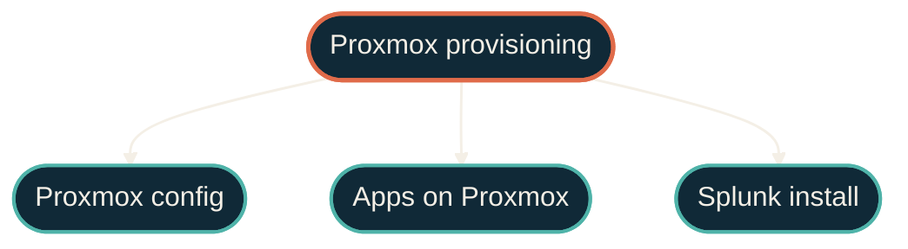

{/* projected from the authoring site; do not edit here */}
OpenTofu builds the box. Ansible makes it useful.

Three Ansible repos cover everything that runs on the provisioned infrastructure: the Proxmox host,
the app stack on top, and Splunk Enterprise. Splunk gets its own repo as a separate concern because
of its scale and uptime requirements.

## Role map

{/*Shape: hierarchy. TF parent → 3 Ansible role children. */}
{/* Nodes: 4. Boundary crossings: 0. Aspect: ~3:2 TB. Pass.*/}

OpenTofu outputs an inventory. Each Ansible role consumes it independently. Ink edges signal control / provisioning hand-off (not data flow).

| Role | Repo | What it does |
| --- | --- | --- |
| Host config | [Proxmox config](/infrastructure/repos/ansible-proxmox) | ZFS, networking, users, performance tuning, monitoring agents |
| Apps on hosts | [Apps on Proxmox](/infrastructure/repos/ansible-proxmox-apps) | HAProxy, Cribl Edge, Cribl Stream |
| Splunk install | [Splunk install](/observability/repos/ansible-splunk) | Splunk Enterprise: indexers, search heads, license, storage tiering |

## Repos in this section

<CardGroup cols={3}>
<Card
  title="ansible-proxmox"
  icon="server"
  href="/infrastructure/repos/ansible-proxmox">
  Proxmox host config — ZFS, networking, users, hardening.
</Card>
<Card
  title="ansible-proxmox-apps"
  icon="boxes-stacked"
  href="/infrastructure/repos/ansible-proxmox-apps">
  HAProxy, Cribl Edge, Cribl Stream on VMs and LXCs.
</Card>
<Card
  title="ansible-splunk"
  icon="chart-line"
  href="/observability/repos/ansible-splunk">
  Splunk Enterprise — indexers, search heads, license.
</Card>
</CardGroup>

## Environment

<Note>
The Ansible inventories read secrets from environment variables. Nothing sensitive lands in git.
</Note>

## Where to go next

<CardGroup>
<Card
  title="Infrastructure overview"
  icon="server"
  href="/infrastructure/overview">
  The OpenTofu side that provisions everything Ansible configures.
</Card>
<Card
  title="tofu-proxmox"
  icon="vault"
  href="/infrastructure/repos/tofu-proxmox">
  How VMs and LXCs are provisioned before Ansible touches them.
</Card>
</CardGroup>
