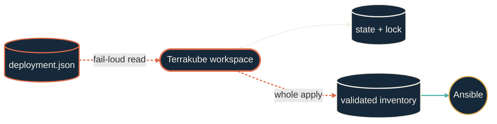

{/* projected from the authoring site; do not edit here */}
Keep one desired-state object, reject stale edits, and let the IaC platform own state and locking.

`deployment.json` is the input to `tofu-proxmox`. It is not state and it is not
an Ansible inventory. A versioned object in the homelab S3-compatible store is
authoritative; local files are temporary.

## Stores and ownership

The published inventory carries shared proxy URL lists under
`cache_proxy_urls`. The [inventory assembly](
https://github.com/dryvist/tofu-proxmox/blob/develop/modules/proxmox-stack/inventory_assembly.tf)
derives them from capability-tagged guest FQDNs, so consumers use one
published endpoint list.

| Store | Holds | Owner |
| --- | --- | --- |
| Homelab object storage | Versioned `deployment.json` input and published Ansible inventory | OpenTofu graph |
| Terrakube workspace | OpenTofu state versions, run queue, and lock | Terrakube |

## ACID guarantees

| Property | Enforcement |
| --- | --- |
| Atomicity | Read and replace one whole object. A missing or blank object aborts the plan. |
| Consistency | Validate desired state before planning and validate inventory before publishing. |
| Isolation | Conditional object writes reject stale editors; Terrakube serializes runs per workspace. |
| Durability | Object versioning and Terrakube state versions survive worktrees and operator machines. |

## Rules

- Never commit the live object or create `terraform.tfvars` beside it.
- Never fall back to `{}` when the object cannot be read.
- Compare the object version when writing so concurrent edits fail cleanly.
- Run `tofu state list` before adopting an existing resource; its key must
  match the desired-state key.
- Run a targeted apply through the gated targeted path. Its plan must destroy
  nothing. A targeted run that leaves out the inventory object does not publish
  inventory. See the
  [targeted-apply runbook](https://github.com/dryvist/iac-platform/blob/main/docs/targeted-apply.md).
- Provider and object-store credentials are not workspace secret variables.

Independent Terrakube workspaces have independent locks. Cross-workspace
production changes use an explicit reviewed sequence, not a universal mutex.
