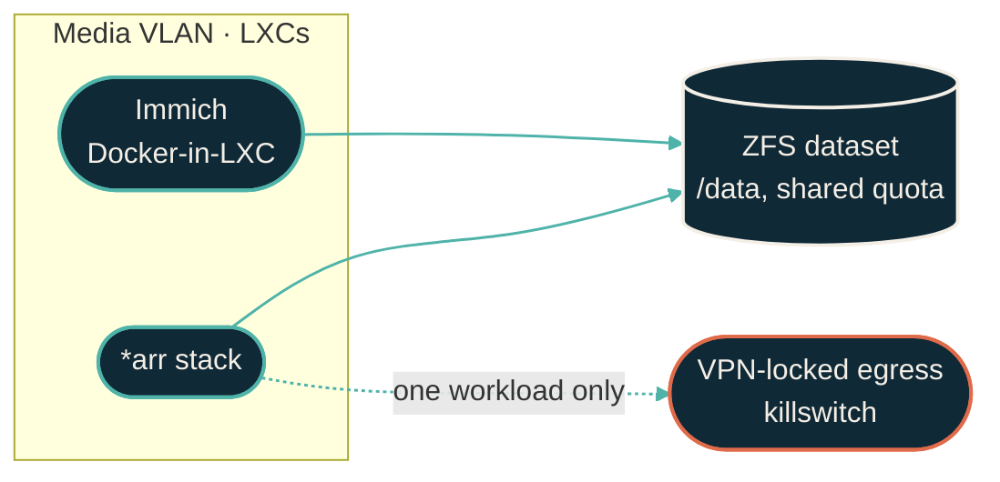

{/* projected from the authoring site; do not edit here */}
{/*Shape: VLAN with shared storage, one workload egresses via VPN. 5 nodes. Aspect ~3:1 LR.*/}

The homelab runs a self-hosted Netflix: a media library served from LXCs on a dedicated VLAN,
managed by Ansible, provisioned by `tofu-proxmox`. The VLAN is defined in `tofu-unifi` alongside
every other service tier, and follows the same per-service segmentation pattern.

## Container choice

LXC, not Docker, consistent with the [LXC vs Docker](/infrastructure/lxc-vs-docker) decision tree. Native packages where they exist; Ansible manages config.

## Storage layout

The whole stack shares **one ZFS dataset** bind-mounted at `/data` into every container. So a
single quota bounds the whole footprint, and every service sees the library at the same path. The
dataset uses `recordsize=1M`, which suits the large sequential files a media server streams.

## Personal backup on the same footprint

The same self-hosted footprint replaces two cloud subscriptions with services that keep the data at home:

- **Immich**: a self-hosted photo and video library, the iCloud Photos alternative. Phones and Macs
  back up automatically to it. It's the one workload here that runs Docker-in-LXC (an official
  multi-container stack), with the photo library living on a ZFS dataset bind-mounted into the
  container.
- **Time Machine**: the Macs back up to an SMB share on the homelab NAS, presented as a native Time
  Machine target (Samba's `vfs_fruit` advertises it as an Apple Time Capsule). The same NAS serves
  read-only media shares for Infuse on Apple TV.

Time Machine backups are not themselves snapshotted or replicated. See the
[ZFS snapshot and replication policy](/infrastructure/zfs-backup-replication).

## Insights dashboard

A dashboard service reads the `*arr` stack's own APIs and surfaces cross-app
health and activity in one view. It needs no separate data store and no ingest
pipeline of its own. It rides the same VLAN, the same Ansible-managed LXC
pattern, and the same persistent-appdata layout as the rest of the stack.

## VPN-locked egress

One workload in this stack keeps its traffic off the local network entirely. Its egress is locked
to a WireGuard tunnel to a VPN provider, enforced by a fail-closed killswitch. There is no tunnel,
no route out, and no silent fallback to the LAN. That path recently gained sticky automatic
failover between two upstream VPN endpoints. It also carries a hard-won lesson on a gateway
IDS/IPS false-positive against encrypted VPN traffic. See
[VPN-locked egress reliability](/infrastructure/vpn-egress-failover).

## Related

<CardGroup>
<Card
  title="LXC vs Docker"
  icon="boxes-stacked"
  href="/infrastructure/lxc-vs-docker">
  Why the decision tree lands on LXC for this stack.
</Card>
<Card
  title="UniFi networking"
  icon="network-wired"
  href="/infrastructure/repos/tofu-unifi">
  Where the media VLAN itself is defined.
</Card>
<Card
  title="VPN-locked egress reliability"
  icon="shield-halved"
  href="/infrastructure/vpn-egress-failover">
  Sticky VPN-endpoint failover, and an IDS/IPS false-positive lesson.
</Card>
  <Card title="Homelab" icon="house" href="/about/homelab">
  What the full cluster looks like.
</Card>
</CardGroup>
