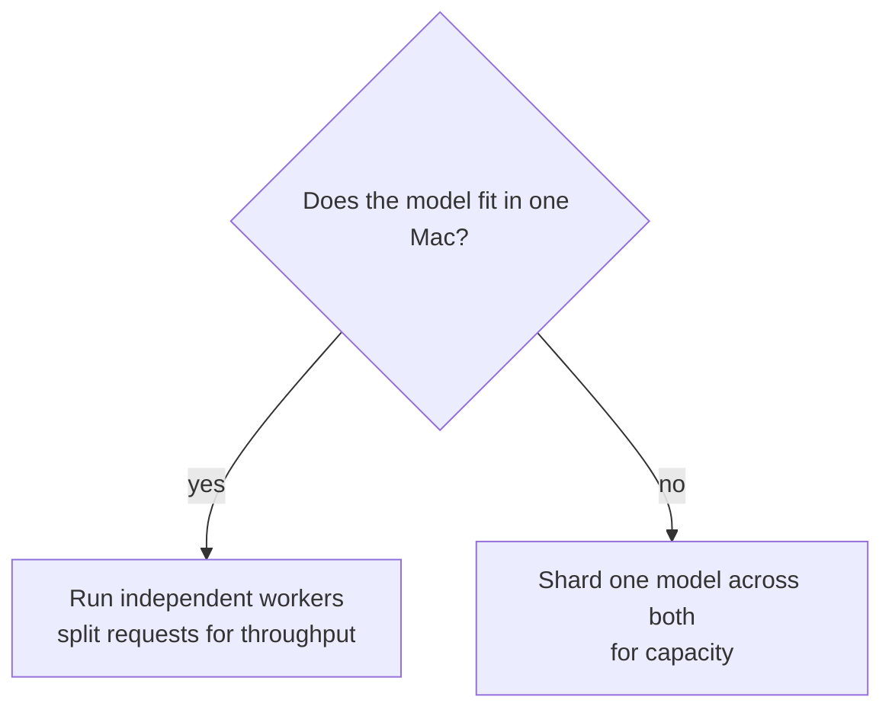

{/* projected from the authoring site; do not edit here */}
> Two Macs can cooperate; they cannot merge. The gain is capacity: serving a model too large for one machine, not making a model that already fits run faster.

MLX distributed can shard one model across separate Apple Silicon memory
pools. The machines exchange activations over a Thunderbolt link using TCP or
the RDMA-based JACCL backend. The link does not turn their unified memory into
one pool.

The lifecycle for this fleet is operator-triggered. Cable connection alone does not join or detach the cluster. The detailed procedure remains in the private runbook.

## The memory trade-off

There is no combined unified-memory pool. Each Mac keeps its own memory, and
the model is divided across the pair. Sharding lets the pair run a model that
exceeds one Mac's capacity. Each rank still needs space for its shard, KV cache,
and runtime overhead.

Measure GPU-wired residency with the platform's wired-memory accounting, not a process's RSS. Unified-memory allocations may not appear in a process's RSS.

## Two workers or one sharded model?

- **If it fits on one Mac,** run an independent worker on each and divide requests between them.
- **If it does not fit,** shard one model across the pair. This trades link traffic and coordination for additional model capacity.

Which parallelism mode a model supports depends on its architecture. Pipeline
and tensor parallelism have different sharding behavior and sizing needs.
Check the model's declared capability before choosing a mode.

## Historical benchmark snapshot

A prior measurement snapshot recorded the then-selected model at the following concurrency levels:

| Concurrency | Aggregate tok/s | Per-stream tok/s |
| --- | ---: | ---: |
| 1 | 59.4 | 59.4 |
| 2 | 109.7 | 54.8 |
| 4 | 175.8 | 44.0 |
| 8 | 232.1 | 29.0 |

Those figures are historical results for the model and configuration used then. The current model selection and benchmark results are UNKNOWN on this page.

## Historical record

The prior automatic link watcher, retry, and recovery lifecycle was removed on
2026-10-18 in favour of manual join and detach. Older root-cause and incident
details are historical and belong to the private operational reference.

## Related

<CardGroup cols={2}>
<Card
  title="Models and quantization"
  icon="layer-group"
  href="/local-llm/models-and-quantization">
  Model formats and quantization choices for local inference.
</Card>
<Card
  title="Apple Silicon stack"
  icon="microchip"
  href="/local-llm/apple-silicon">
  The single-Mac serving stack and its tuning controls.
</Card>
<Card
  title="Benchmarking"
  icon="gauge-high"
  href="/tools/mlx-benchmarks">
  The method and result records for MLX benchmarks.
</Card>
</CardGroup>
