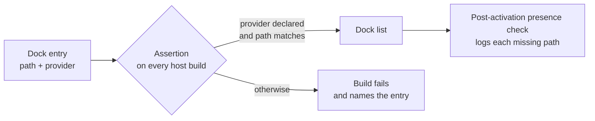

{/* projected from the authoring site; do not edit here */}
import { RepoMeta, RepoFit } from "/snippets/repo-summary.mdx";

> The macOS system layer. Everything below it is just `inputs`.

<RepoMeta language="Nix" status="active" lastActive="this week" repoUrl="https://github.com/dryvist/nix-darwin" />

`nix-darwin` is the top-level entry point for the Mac. One `darwin-rebuild switch` updates packages, fonts, app preferences, shell, and dock: anything that has a system-level reflection.

## What it does

- Manages `environment.systemPackages`: the global PATH baseline
- Owns macOS defaults: dock, finder, screenshots, keyboard, trackpad
- Imports [`nix-home`](/nix/nix-home) as `home-manager` input for user-level config
- Imports [`nix-ai`](/nix/nix-ai) for AI tooling that should live on the system PATH
- Pins the nixpkgs channel and applies overlays once for the whole machine
- Runs the `dev.local.ws-monitor` LaunchDaemon, which saves WindowServer captures on a freeze
  ([module](https://github.com/dryvist/nix-darwin/blob/v4.11.0/modules/darwin/ws-monitor.nix))
- Enables tailspin during activation

## How it fits

| Imports | Applies to |
| --- | --- |
| [User environment](/nix/nix-home), [AI tooling](/nix/nix-ai) | macOS system (via `darwin-rebuild switch`) |

<RepoFit>
The orchestrator. If a tool needs to be on every shell session by default, it belongs here.
</RepoFit>

## Dock apps and their providers

Every Dock entry names the provider that installs it, and a build-time assertion on every host checks the pair. The Dock list in
[`persistent-apps.nix`](https://github.com/dryvist/nix-darwin/blob/develop/modules/darwin/dock/persistent-apps.nix) is derived from those entries.
The contract lives in [`lib/dock-apps.nix`](https://github.com/dryvist/nix-darwin/blob/develop/lib/dock-apps.nix).

| Provider | Declared in | Installs under |
| --- | --- | --- |
| `system` | macOS | shipped with macOS |
| `cask` | `homebrew.casks` | `/Applications` |
| `mas` | `homebrew.masApps` | `/Applications` |
| `nixpkgs` | a home-manager `home.packages` | `~/Applications/Home Manager Apps` |
| `manual` | outside this configuration, with a written reason | any path |

The `dock-providers` flake check runs the contract against a fixture for each failure mode and confirms every Mac host carries the assertion.
The macOS build job on `main` runs `nix flake check`, which builds every `checks.aarch64-darwin` output, including `dock-providers` and `system-eval` (the assertion for every host).
A check declared in `flake.nix` runs there without a second list.
The Obsidian package puts the app bundle under Home Manager Apps and links the `obsidian` command to the app's socket CLI; the GUI executable is not on `PATH`.
Workstation Homebrew cleanup runs in `check` mode: activation stops and lists every installed cask or formula the configuration does not declare, and removes nothing.
To add or move an app, change the provider declaration and the Dock entry together.

## Getting started

<Steps>
<Step title="Install Nix and the Determinate installer">
Use the Determinate Nix installer for flakes-enabled macOS. The README links the exact command.
</Step>
<Step title="Clone and run the bootstrap">
`git clone https://github.com/dryvist/nix-darwin && cd nix-darwin && darwin-rebuild switch --flake .#$(hostname -s)`
</Step>
<Step title="Iterate">
Edit `flake.nix` or any module under `modules/`. Re-run `darwin-rebuild switch --flake .`; only what changed gets rebuilt.
</Step>
</Steps>

## Related repos

<CardGroup cols={2}>
  <Card title="nix-home" icon="house" href="/nix/nix-home">
  The user-level layer imported here.
</Card>
  <Card title="nix-ai" icon="bot" href="/nix/nix-ai">
  The AI tooling imported here.
</Card>
<Card
  title="nix-devenv"
  icon="cube"
  href="/nix/nix-devenv">
  Per-project dev shells: entered via direnv, not declared here.
</Card>
<Card
  title="Source on GitHub"
  icon="github"
  href="https://github.com/dryvist/nix-darwin">
  Modules, host configs, full README.
</Card>
</CardGroup>
