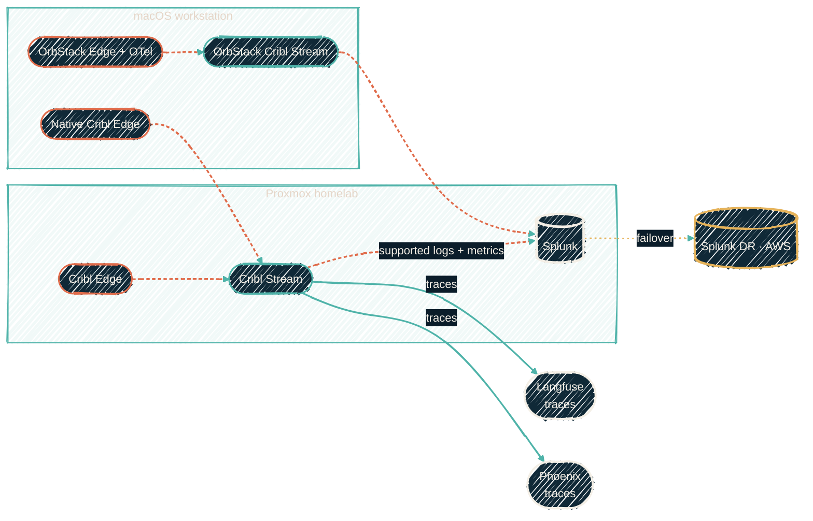

{/* projected from the authoring site; do not edit here */}
> One picture: every collector, what it collects, where it runs, what it forwards to.

The monitoring stack runs across four hosts. These are the homelab Proxmox cluster, the macOS workstation, the
OrbStack K8s cluster on that workstation, and the
AWS-side Splunk install. Each tier picks the lowest-overhead path the host OS supports natively.
This page maps every collector to a host and a destination.

{/*Shape: parallel convergence. Two host subgraphs; homelab trace routes split to Langfuse and Phoenix; Splunk is the failover source. 9 nodes, ≤1 boundary per edge.*/}

Every Edge feeds a Stream. In the homelab AI path, supported logs and metrics
go to Splunk while traces are routed to Langfuse and Phoenix.
The trace routes are **merged in git; NOT DEPLOYED** yet, so see [LLM observability](/observability/llm-observability) for status.
The AWS tier is one routing-rule flip away. Detail per collector below.

## The collectors

| Collector | Where it runs | What it collects | Forwards to |
| --- | --- | --- | --- |
| `cribl-edge` (homelab) | LXC on Proxmox, deployed by Ansible | HAProxy syslog/NetFlow, host telemetry from Proxmox guests | `cribl-stream` (homelab) |
| `cribl-stream` (homelab) | LXC on Proxmox, deployed by Ansible | Edge events, volume reduction, routing | Supported logs and metrics to Splunk; AI traces to Langfuse and Phoenix (merged, not yet deployed) |
| `cribl-edge` (Mac native) | Native macOS Cribl Edge, **standalone**. It uses nix-darwin GitOps, with no Leader, no hosted-service fleet enrollment | macOS unified logs, system metrics, thermal, powermetrics, battery via the macOS host telemetry pack, WindowServer monitor samples and capture summaries; AI command-line tools / LLM stack / audit log files | `cribl-stream` (homelab), tcpjson over Cribl S2S |
| `cribl-edge-standalone` (OrbStack) | StatefulSet in the OrbStack cluster's `monitoring` namespace | AI tool telemetry: Claude Code (OTLP), Gemini Antigravity, VS Code | `cribl-stream-standalone` (OrbStack) |
| `cribl-edge-managed` (OrbStack) | StatefulSet in the OrbStack cluster | Subset of telemetry tagged for Cribl's hosted service | Cribl's hosted service |
| `cribl-stream-standalone` (OrbStack) | StatefulSet in the OrbStack cluster | Edge events + REST poll from `cc-stream-github-copilot-rest-io` | Splunk HEC |
| `otel-collector` (OrbStack) | StatefulSet in the OrbStack cluster | OTLP from Claude Code SDK, any in-cluster OTLP source | `cribl-stream-standalone` (OrbStack) |

## Splunk egress paths

Standard Edge events go to Stream for routing to Splunk. Homelab AI traces take
separate Cribl routes to Langfuse and Phoenix (merged, not yet deployed); Splunk
receives no traces.
On OrbStack, network policies lock Edge egress to Stream on the HEC port only.
For other homelab Edge events, the single Stream tier remains the Splunk egress;
firewall rules reinforce that path.

For the routed Edge-to-Stream path, two as-built details are:

- **Edge → Stream rides Cribl S2S** as tcpjson.
- **Stream → Splunk is one HEC output per index**, each with its own token
  scoped to one index. See the [full family/port/index
  map](/observability/overview#syslog-intake-families).

## Per-tool Cribl Edge packs

The AI-coding-tool packs sit on top of the OrbStack cluster's `cribl-edge-standalone`:

| Pack | Collects from |
| --- | --- |
| [`cc-edge-claude-code-otel`](https://github.com/JacobPEvans-personal/cc-edge-claude-code-otel) | Claude Code (OTEL hooks) |
| [`cc-edge-copilot-otel`](https://github.com/JacobPEvans-personal/cc-edge-copilot-otel) | GitHub Copilot Chat (OTLP gRPC) |
| [`cc-edge-vscode-io`](https://github.com/JacobPEvans-personal/cc-edge-vscode-io) | VS Code (logs + telemetry) |
| [`cc-edge-gemini-antigravity-io`](https://github.com/JacobPEvans-personal/cc-edge-gemini-antigravity-io) | Gemini Antigravity |

The macOS host telemetry pack targets the **native macOS** Cribl Edge install, not the
OrbStack-deployed one. Its exec inputs call macOS-only binaries that need host access, not a Linux
container.

## Configuration ownership

Reusable content follows the [observability ownership rule](/observability/overview#reusable-observability-content).
Ansible repositories carry environment wiring for the collectors and services
on this map.

## REST collectors

| Pack | Polls | Hosted on |
| --- | --- | --- |
| [`cc-stream-github-copilot-rest-io`](https://github.com/JacobPEvans-personal/cc-stream-github-copilot-rest-io) | GitHub Copilot usage metrics REST API (per-org, per-seat) | `cribl-stream-standalone` (OrbStack) |

REST collectors run on Stream rather than Edge because they're pull-based jobs against authenticated
APIs. That is closer to the routing layer's responsibility than the host-side capture layer.

## OTel collectors

| Collector | Where | Role |
| --- | --- | --- |
| `otel-collector` (OrbStack) | StatefulSet in the OrbStack cluster | OTLP gRPC/HTTP receiver, forwards to `cribl-stream-standalone` |

Anything inside the OrbStack cluster that speaks OTLP gets pointed at the in-cluster OTel collector.
Anything outside the cluster but on the same Mac (Claude Code, Gemini Antigravity, VS Code) talks to
the OTel collector through the NodePort. Otherwise, it hands off to the Cribl Edge standalone pack.

## Heartbeats

Four [healthchecks.io](https://healthchecks.io) CronJobs run in the OrbStack `monitoring` namespace as dead-man switches:

| CronJob | Pings when |
| --- | --- |
| `pipeline-heartbeat` | Cribl Stream is alive and routing |
| `heartbeat-splunk` | Splunk HEC accepts the test event |
| `heartbeat-edge` | Cribl Edge processes the test event |
| `heartbeat-otel` | OTel collector receives a test span |

A missed ping is the first signal of a broken pipeline. Every other failure mode tends to be silent.

Heartbeats prove the pipeline is up; **per-index silence detectors** prove the data is flowing.
Every Splunk index carries an alert that fires when the index receives no events within its expected
cadence. A dead sender, port, or token then surfaces as "index went quiet" rather than a gap
discovered at search time.

## Forwarding to AWS DR

The Splunk install behind `cribl-stream` is the homelab indexer.
The AWS-side DR footprint is provisioned separately:
same data shape, smaller indexer tier, ready to take a failover. Cribl Stream's output config can be
flipped from the homelab Splunk to the AWS HEC endpoint via a routing-rule change. Downstream
AI-observability dashboards keep working because they target the same indexes regardless of which
Splunk tier is live.

## See also

<CardGroup cols={2}>
<Card
  title="Observability overview"
  icon="chart-line"
  href="/observability/overview">
  Cribl routes supported logs and metrics to Splunk. Trace routes to Langfuse and Phoenix are merged, not yet deployed.
</Card>
</CardGroup>

